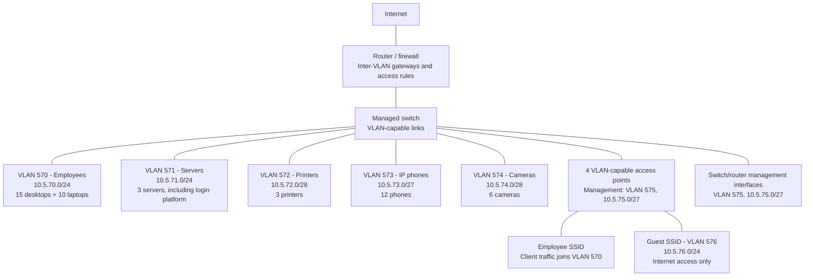
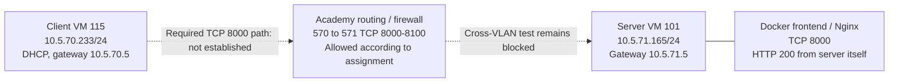

# CDS compulsory assignment

Login and user management platform for Kvist & Bjælke ApS, with network planning and Docker deployment. This README is the combined report for **CDS.security** and **CDS.infrastructure**.

Status (4 November 2026): the application passed local Docker, API, and browser tests. All three containers are running on the academy server, and its web service returns HTTP 200 locally. Login and role tests on that deployment and direct access from the client remain pending; the server cannot currently reach its gateway.

## Responsibilities

| Member | GitHub | Responsibility |
| --- | --- | --- |
| Samuele | [zsaamu](https://github.com/zsaamu) | Network plan, VMs, testing, report coordination, and final review/merge |
| Kyrylo | [Kyrylo-Vorona](https://github.com/Kyrylo-Vorona) | User account storage, username/password authentication, password hashing, and role permissions |
| Azade | [azade1416](https://github.com/azade1416) | Web login, user table, and account management actions for each role |

Each member documents their own work. Samuele and Kyrylo handle Docker deployment together.

## First Admin Setup

After starting the containers below, open the database console:

```sh
docker compose exec postgres psql -U admin -d kvist_db
```

Run this query once on a fresh database to create the local test admin:

```sql
INSERT INTO "Users" ("Fullname", "Username", "PasswordHash", "Role")
VALUES ('System Admin', '@admin', '$2a$11$JkBFAUgXsNma2OWzqtTQkOXVsiHTCRpYyRQ3/YX8armgq4nmqWKbC', 'admin');
```
Log in with username `@admin` and password `password`. These are test-only credentials. Exit the database console with `\q`.

## How to Run (Setup Instructions)

Docker and Docker Compose must be installed and running. Use the latest `main` and run the following steps from the repository root.

1. Create a local `.env` file with the two required variables:

```dotenv
JWT_KEY=<generated-JWT-secret>
POSTGRES_PASSWORD=<generated-database-password>
```

Replace both placeholders with generated values. On Ubuntu, run `openssl rand -hex 32` for the JWT secret and `openssl rand -hex 24` for the database password, then copy each result into its corresponding variable. Keep `.env` local; Git ignores it.

For this Docker setup, remove any old `VITE_API_URL` setting from the build environment and local Vite environment files. The frontend uses the current server address and Nginx forwards `/api` requests to the internal backend.

2. Build and start all three services:

```sh
docker compose up --build -d --wait
docker compose ps
```

3. Create the first admin using the section above. The database starts automatically, but the admin account is created manually.

4. Open the application:

| Access | Application | Swagger |
| --- | --- | --- |
| On the server itself | `http://localhost:8000` | `http://localhost:8000/swagger` |
| From the client VM | `http://<server-IP>:8000` | `http://<server-IP>:8000/swagger` |

Replace `<server-IP>` with the server VM's assigned address. TCP port **8000** is published by Nginx; the backend is reached through Nginx inside the Docker network.
   
## Security Architecture
### Password Hashing (BCrypt)
User passwords are never saved in plain text in the database.

We use the BCrypt library (BCrypt.Net-Next) to hash passwords securely with an automatic salt.

This protects user data against database leaks and password cracking attacks.

### Authentication & Authorization (JWT)
The project uses JWT (JSON Web Tokens) for secure, stateless login.

After a successful login, the server creates a token using a secret key.

The token includes the user's ID, username, and role.

**Instant Session Control**: To keep the app secure, every protected request checks the database to verify if the user still exists and has the correct role. If an account is deleted or changed, the access updates immediately.

### How to test using Swagger UI
Send a POST request to `/api/Auth/login` using a test account's username and password.

Copy the token value from the response body.

Click the Authorize button (the lock icon) at the top right of the Swagger UI page.

Paste your token into the input field. (Note: You do not need to type the word "Bearer", just paste the token code).

Click Authorize and close the window. You can now test all protected endpoints based on your user role.

## Issues and workflow

The [issues](https://github.com/zsaamu/cds-compulsory-assignment/issues) contain owners and completion checks. The [project board](https://github.com/users/zsaamu/projects/3/views/1) uses Todo, In Progress, and Done. An open issue can have completed code while report evidence or final integration is still pending.

Changes reach `main` through pull requests reviewed, tested, and merged by Samuele.

### Remaining work after the 4 November lab session

| Work | Owner / support | Status and next action |
| --- | --- | --- |
| Lab connection and server gateway, #2 | Samuele with Henrik/IT; Kyrylo supplies handover | Blocked: server cannot reach 10.5.71.5. Confirm VM attachment and upstream VLAN path; approved remote access is unconfirmed. |
| Company IP plan and diagrams, #10 / #11 | Samuele | Written in PR #26. Review subnet choices and rendered diagrams, then merge; these tasks do not require a working lab network. |
| Docker deployment, #12 | Kyrylo | Done for packaging and server-side serving: three services running, HTTP 200 on server IP port 8000. Cross-VLAN use is tracked separately in #14. |
| VM configuration evidence, #13 | Samuele; Kyrylo hands over existing VMs | In progress: collect final client adapter/DNS, confirm disk installation, and resolve server gateway connectivity. |
| Academy login, roles and direct client access, #14 | Samuele with group support | Pending: first-admin/login verification, client-to-server access and all three role checks. The attempted login command did not execute; HTTP 200 alone is not a login test. |
| Local security evidence, #8 | Samuele | Local role tests passed; add results to the report. Keep them separate from academy tests. |
| Frontend explanation and screenshots, #9 | Azade; Samuele reviews | Local browser tests passed. Review PR #25 and integrate its evidence without replacing newer setup/network documentation. |
| Combined README and reflection, #15 | Samuele coordinates; each member documents their part | In progress from home: integrate evidence, alternatives, final reflection and documentation PRs. |
| Final requirements review, #16 | Samuele | Todo after the report and test results are ready; record any unresolved requirement and teacher guidance. |
| Moodle group and submission, #17 | Samuele | Todo: confirm group registration, assessor access and submission receipt before 6 November at 23:59. |

Kyrylo's handover should identify the two VM accounts, admin-account creation status, final client network setting, local changes and whether the VMs are running. Share credentials privately and preserve the existing project, `.env`, database volume and VM disks. VM addresses are DHCP leases and must be checked again on the next visit.

## Work plan

| Date (2026) | Work and result / target |
| --- | --- |
| 26-30 October | Repository and roles set up; frontend/backend integrated and locally tested; full Docker setup merged. |
| 4 November | Academy server deployment and client VM prepared. Client reaches its gateway; server gateway and direct cross-VLAN test remain blocked. Company IP plan and diagrams completed in PR #26. |
| Thursday 5 November | Samuele resumes the existing VMs, seeks Henrik/IT guidance, retries academy login/role and cross-VLAN checks, and gathers missing evidence. In parallel, finish the README and review PRs #25/#26 from home. |
| Friday 6 November | Review the final main version, verify Moodle group/access, and submit before 23:59. If connectivity is still blocked, record the limitation and the teacher's response; do not count it as a passed test. |

Work is scheduled on weekdays only. The original 4 November early-submission target was not reached. These revised targets do not change the official deadline. The [milestones](https://github.com/zsaamu/cds-compulsory-assignment/milestones) group the issues; current remaining actions and targets are listed above and in each issue.

## CDS.security

### Application requirements

- Web application with username/password login.
- Passwords stored with a secure password-hashing algorithm and never exposed in plaintext.
- Backend authorization for the three required roles.
- Application capable of running in Docker.

| Action | User | Superuser | Admin |
| --- | --- | --- | --- |
| Read the user table | Yes | Yes | Yes |
| Create, update, and delete ordinary user accounts | No | Yes | Yes |
| Create, update, and delete superuser or admin accounts | No | No | Yes |
| Assign or change a privileged role | No | No | Yes |

Account actions must respect these permissions. Passwords and hashes must not appear in the user table or application responses.

Technologies and frameworks are the team's choice and must be justified, particularly regarding security.

### Required documentation

The report must describe the platform, implemented security features, technology choices, and security alternatives considered, with relevant screenshots and results.

## CDS.infrastructure

### Company network plan

The tables below define the proposed company design. The assignment fixes VLANs 570 and 571 and their /24 networks. Their proposed gateways use the .5 addresses observed in the academy on 4 November 2026. VLANs 572-576, their gateways, and all company device allocations are design choices. Only the server and client networks are implemented for the assignment; the remaining segments describe the company proposal. The lab record below reports actual settings and test results separately. A configured gateway is not evidence that it is reachable.

The inventory contains 15 desktops, 10 laptops, 3 printers, 3 servers, 12 IP phones, 4 access points, 6 cameras, network equipment as required, and a variable number of guest devices. The employee network therefore starts with 25 computers. For sizing only, this plan assumes up to 100 concurrent guest devices; the brief does not specify a guest count.

#### Proposed subnets

All addresses use the private 10.0.0.0/8 range. Each VLAN has a separate subnet and a gateway interface on the router/firewall. Usable addresses exclude the network and broadcast addresses; the gateway consumes one usable address.

| VLAN | Group and current demand | Network/CIDR | Subnet mask | Proposed gateway | Usable addresses |
| --- | --- | --- | --- | --- | --- |
| 570 | Employees: 15 desktops + 10 laptops | 10.5.70.0/24 | 255.255.255.0 | 10.5.70.5 | 254 |
| 571 | Servers: 3 | 10.5.71.0/24 | 255.255.255.0 | 10.5.71.5 | 254 |
| 572 | Printers: 3 | 10.5.72.0/28 | 255.255.255.240 | 10.5.72.1 | 14 |
| 573 | IP phones: 12 | 10.5.73.0/27 | 255.255.255.224 | 10.5.73.1 | 30 |
| 574 | Cameras: 6 | 10.5.74.0/28 | 255.255.255.240 | 10.5.74.1 | 14 |
| 575 | Management: 4 access points + network equipment | 10.5.75.0/27 | 255.255.255.224 | 10.5.75.1 | 30 |
| 576 | Guests: variable; sizing assumption of 100 | 10.5.76.0/24 | 255.255.255.0 | 10.5.76.1 | 254 |

#### Address allocation and growth

Static addresses keep servers and shared equipment reachable at a stable address. DHCP assigns addresses automatically to employee computers, phones, and guests. Fixed addresses and gateways are outside the DHCP pools.

| VLAN | Proposed device allocation | Growth capacity |
| --- | --- | --- |
| 570 | DHCP: 10.5.70.50-10.5.70.199 | Pool supports 150 computers, compared with 25 today. Other host addresses remain reserved. |
| 571 | Static servers: 10.5.71.10-10.5.71.12; application server proposed at 10.5.71.10 | 253 device addresses after the gateway. Keep the assignment's /24 even though three servers need much less space. |
| 572 | Static printers: 10.5.72.2-10.5.72.4 | 13 device addresses after the gateway; room for 10 additional printers. |
| 573 | DHCP: 10.5.73.2-10.5.73.30 | Pool supports 29 phones; room for 17 additional phones. |
| 574 | Static cameras: 10.5.74.2-10.5.74.7 | 13 device addresses after the gateway; room for 7 additional cameras. |
| 575 | Static access points: 10.5.75.2-10.5.75.5; switches and other management interfaces: 10.5.75.6-10.5.75.30 | 29 device addresses after the gateway, including the 4 access points. Size the final equipment order within this capacity; expand the management subnet if more than 25 additional interfaces are needed. |
| 576 | DHCP: 10.5.76.20-10.5.76.219 | Pool supports 200 guests, leaving 100 spare leases above the sizing assumption. |

Company DHCP scopes should supply their segment gateway and an approved DNS resolver. For this proposal, use 10.5.71.5 as the internal DNS resolver, matching the server's observed academy DNS setting; permit client DNS requests over UDP/TCP 53 to that resolver. This is a design choice for the company, not a claim that DNS from every academy VLAN has been tested. Guest DHCP should advertise an approved public resolver and the firewall should prevent access to internal networks. Unallocated addresses are reserved for future use. If demand exceeds a subnet's capacity, revise the subnet and DHCP scope before adding devices; none of these subnets overlap.

The proposed employee pool (.50-.199) and static server range (.10-.12) are for the company design. The academy's observed DHCP leases, client .233 and server .165, are outside those planned ranges and remain unchanged. For a real deployment, reserve the application server's address in DHCP or assign a coordinated static address so clients have a stable destination.

#### Why the groups are separated

Employee computers and servers use separate networks so access to services can be controlled at the router/firewall. Printers, phones, and cameras each have their own segment because they perform different jobs and need different access rules. Management interfaces are separated from everyday traffic. The four access points have management addresses in VLAN 575; in this proposed design, employee Wi-Fi traffic joins VLAN 570 and guest Wi-Fi traffic joins VLAN 576 through separate SSIDs and VLAN-capable equipment.

The proposed company policy is to allow only required traffic between VLANs. Employees need access to the login service and printing. Guests need Internet access without access to company or management networks. Camera access should be limited to the authorized viewing or recording service, and device administration should be limited to an approved management workstation. The exact business-service ports and management access rules must be confirmed before implementation. VLANs provide segmentation; routing and firewall rules determine permitted communication.

In the academy, the required test is the VLAN 570 client reaching the VLAN 571 application on TCP port 8000. The assignment states that the network firewall already permits TCP 8000-8100 in that direction. Record the result of that test separately from this proposed company policy.

#### Subnetting examples

| Example | Network | Mask | Usable host range | Broadcast | Calculation |
| --- | --- | --- | --- | --- | --- |
| Employees | 10.5.70.0/24 | 255.255.255.0 | 10.5.70.1-10.5.70.254 | 10.5.70.255 | 2^(32-24) - 2 = 254 usable addresses |
| IP phones | 10.5.73.0/27 | 255.255.255.224 | 10.5.73.1-10.5.73.30 | 10.5.73.31 | 2^(32-27) - 2 = 30 usable addresses |

The employee /24 is specified by the assignment and provides space beyond the 25 current computers. After reserving the gateway, 253 device addresses remain; the initial DHCP pool uses 150 of them. A /27 fits the 12 phones and allows growth: after the gateway, 29 phone addresses remain. A /28 would leave only 13 phone addresses after its gateway, allowing just one additional phone, so this plan chooses /27.

#### Company network diagram

This diagram is the proposed company topology. The router/firewall provides a gateway for each segment, routes permitted traffic between them, and controls Internet access. The managed switch carries VLANs to the relevant devices. Lines show network connections; they do not grant unrestricted access between segments.



Employee computers reach the login platform through the firewall on TCP 8000. Printers and other business services need their own explicit rules. The access points have management addresses in VLAN 575 while forwarding employee and guest traffic into separate VLANs. The listed 10 laptops are part of the 25 employee computers, not extra devices added by the Wi-Fi diagram. Switch quantity and port count depend on cabling and PoE needs; access points, cameras, phones, uplinks, and growth must be included when selecting equipment.

To revise the plan, update the subnet table, address allocation, diagram labels, gateway/DNS settings, and any affected subnetting example together. Keep the assigned VLAN 570 and 571 /24 networks.

### Lab deployment

The following settings were recorded from Kyrylo's academy screenshots on 4 November 2026. Addresses obtained through DHCP may change on a later visit; check them before testing.

| Actual setting | Server | Client |
| --- | --- | --- |
| Proxmox node | pve02 | pve02 |
| VM name / ID | Azade-kas / 101 | client-ubuntu-desktop / 115 |
| Operating system | Ubuntu Server; hostnamectl reports Ubuntu 26.04.1 LTS | Ubuntu Desktop; exact version and boot from installed disk still to confirm |
| Interface | ens18 | ens18 |
| IP address / prefix | 10.5.71.165/24 | 10.5.70.233/24 |
| Default gateway | 10.5.71.5, supplied through DHCP | 10.5.70.5, supplied through DHCP |
| DNS resolver | 10.5.71.5 | Not yet captured |
| Address assignment | DHCP; route output identifies DHCP configuration | DHCP; route output identifies DHCP configuration |
| Proxmox bridge | vmbr0 | vmbr0 |
| Explicit VM VLAN tag | 571 | Tag 570 was used during the failed DHCP attempt; DHCP succeeded after the instructed untagged test. A final adapter screenshot is still needed to confirm the saved setting and lab mapping. |
| Gateway test | Failed; neighbour entry for 10.5.71.5 is FAILED | Passed: 3 replies from 10.5.70.5, 0% loss |

The Proxmox host has management address 10.5.70.12/24 and gateway 10.5.70.5 on vmbr0. Its recorded configuration has bridge port nic0, VLAN awareness enabled, and bridge-vids 2-4094. This permits VLAN 571 in the host configuration, but does not prove the upstream switch carries it correctly. DHCP success on the untagged client connection suggests that the 10.5.70.0/24 network is presented untagged on this uplink; the physical switch mapping to VLAN 570 remains to be confirmed.

The observed container deployment uses Docker 29.9.2, Docker Compose v5.6.1, and application commit 81e1227. PostgreSQL is healthy; backend and frontend are running. Nginx publishes TCP 8000 and forwards API requests to the backend inside Docker. Port 8000 is within the assignment's allowed range, 8000-8100. HTTP 200 from the server confirms the web page is served, not that authentication or role operations passed on this deployment.

#### Academy communication path and current result



This diagram shows the required logical path, not a successful cross-VLAN test. The client can reach its gateway and selects a route to the server through 10.5.70.5. The server selects its return route through 10.5.71.5, but cannot resolve/reach that gateway. UFW is inactive on the server; this does not establish the state of Proxmox or upstream firewall rules. No shared bridge, switch, or network firewall changes were made.

#### Troubleshooting record and remaining checks

| Check or change | Recorded result | Meaning / next step |
| --- | --- | --- |
| Client initially had a 169.254.x.x address | No usable address in the assigned subnet and no default route | Check VM attachment and IPv4 configuration |
| Manual client 10.5.70.50/24 with gateway 10.5.70.1 | Gateway neighbour resolution failed | .1 was unverified and is not the gateway later observed on the lab host or obtained by client DHCP |
| DHCP with explicit VM tag 570 | Connection activation failed; no IPv4 address or route | DHCP did not complete on that attachment; the cause was not established |
| Client DHCP after the untagged connection test | 10.5.70.233/24 and gateway 10.5.70.5; gateway ping passed | Client connectivity to its gateway restored; confirm final adapter setting |
| Server curl to localhost:8000 and 10.5.71.165:8000 | HTTP 200 | Web service works from the server itself |
| Client browser and TCP connection to 10.5.71.165:8000 | Browser unable to connect; TCP reports No route to host | Direct client-to-application requirement not yet demonstrated |
| Server gateway test | Destination Host Unreachable; neighbour 10.5.71.5 FAILED | Investigate server VLAN attachment, gateway availability, and upstream VLAN path |
| Academy login API test | curl command failed to parse (No URL specified); retry not confirmed | No login success/failure conclusion can be drawn from that attempt |

The underlying server-side connectivity cause is unresolved. It may involve VM attachment or the shared network; the current evidence does not establish responsibility. The group has asked the teacher to review the configuration and advise how to handle the blocked requirement before submission.

Remaining academy checks are direct client access to http://10.5.71.165:8000, a confirmed admin login, permitted and rejected actions for all three roles, client DNS, the final client adapter configuration, and confirmation that the client boots from its installed disk. Record any resolution and repeat the cross-VLAN tests. Existing local role tests remain separate evidence and do not replace these checks.

### Required evidence and explanation

Document Ubuntu Server installation, both VMs' IP configuration, Docker installation, the running container and published port, and successful use of the platform from the client VM.

Explain VLAN separation, routing between the networks, the firewall's role, and why access is limited to specific ports. Record implementation problems, their causes, fixes, and retest results.

## Final report and submission

Complete the Security and Infrastructure sections with the implemented solution, screenshots, tables, diagrams, and test results. Conclude with a short reflection on how security and infrastructure connect, deployment lessons, and changes needed for a real company.

Register the group on Moodle, confirm the assessor can access the GitHub repository, and submit through Moodle by **6 November 2026 at 23:59**. The original early-submission target was **4 November**; the academy connectivity test was still blocked on that date.

Source: `Compulsory-assignment.pdf`, case Kvist & Bjælke ApS, pages 2-9.
