# KAS: CDS Security & Infrastructure

Login and user management platform for **Kvist & Bjælke ApS**. This README is the combined report for CDS.security and CDS.infrastructure. The source code is available in [this repository](https://github.com/zsaamu/cds-compulsory-assignment).

The application was deployed on Ubuntu Server in Proxmox and accessed from a separate Ubuntu Desktop VM. On 5 November 2026, client-to-server access, browser operations for all three roles and 41 API checks passed. The final recorded academy URL is `http://10.5.71.164:8000`; the server address is a DHCP lease.

## Contents

- [Team and work completed](#team-and-work-completed)
- [CDS.security](#cdssecurity)
- [CDS.infrastructure](#cdsinfrastructure)
- [Final reflection](#final-reflection)

## Team and work completed

| Member | Contribution |
| --- | --- |
| Samuele ([zsaamu](https://github.com/zsaamu)) | Repository coordination, company IP plan, diagrams, deployment verification, network troubleshooting, testing and combined report. |
| Kyrylo ([Kyrylo-Vorona](https://github.com/Kyrylo-Vorona)) | PostgreSQL data model, backend authentication, BCrypt, JWT, role authorization, Docker setup and academy deployment/client configuration. |
| Azade ([azade1416](https://github.com/azade1416)) | React frontend, login form, role-aware account management, frontend documentation, Ubuntu Server setup and Docker installation. |

| Period (2026) | Work completed |
| --- | --- |
| 26-28 October | Repository and responsibilities established; backend and frontend developed, integrated and tested; unused registration DTO removed. |
| 29-30 October | Full Docker setup and API routing merged; initial Ubuntu Server and Docker installation completed. |
| 2-4 November | Company addressing plan and diagrams drafted; academy server deployed and Ubuntu Desktop client prepared. Initial cross-subnet access failed. |
| 5 November | Server VM attachment corrected; DHCP and gateway connectivity restored; client browser and API tests completed; final evidence and report assembled. |

Task ownership is recorded in the [issues](https://github.com/zsaamu/cds-compulsory-assignment/issues) and [project board](https://github.com/users/zsaamu/projects/3/views/1).

## CDS.security

### Platform and security

The frontend has a login form, a user table and an account dialog. React keeps these in small components; TypeScript defines account and role types. An ASP.NET Core (.NET 10) API handles authentication, validation and authorization. Entity Framework Core accesses PostgreSQL through Npgsql.

Nginx serves React and forwards `/api/` and `/swagger` to the backend. Browser requests use the current server address, avoiding a hardcoded localhost API URL. Docker Compose runs the three services and keeps PostgreSQL data in a persistent volume.

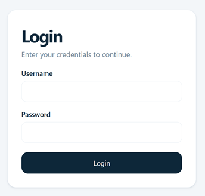

`AuthController` hashes passwords with BCrypt.Net-Next 4.0.3 and checks them with `BCrypt.Verify`. BCrypt stores a salt, cost and hash in each result, slowing offline guessing. The database stores `Id`, `Fullname`, `Username`, `PasswordHash` and `Role`; account responses omit the hash. Passwords are never stored as plaintext user records or returned by the API. The academy uses HTTP, so submitted credentials still need HTTPS protection in a company deployment.

After login, `TokenService` issues an HMAC-SHA256 signed JWT with account ID, username, role and a three-hour expiry. ASP.NET validates its signature, issuer, audience and lifetime. The frontend keeps the token in React memory and sends it in the `Authorization: Bearer <token>` header. Refreshing the page requires login again. JWT payloads are readable, so they contain no password.

Every protected account endpoint also retrieves the current database account. Authorization uses its current role: role changes apply to existing sessions immediately, and deletion invalidates that account's existing sessions. Public registration is absent; permitted roles create accounts.

### Authorization and interface

| Operation | User | Superuser | Admin |
| --- | --- | --- | --- |
| Read account details and roles | Yes | Yes | Yes |
| Create, edit and delete ordinary users | No | Yes | Yes |
| Create, edit and delete superusers/admins | No | No | Yes |
| Assign a privileged role | No | No | Yes |

The backend enforces permissions independently of UI controls: ordinary-user writes return 403, forbidden superuser operations return 400, and missing/invalid authentication returns 401. The UI hides user write controls and restricts superusers to ordinary accounts.

The following screenshots were taken in Firefox inside academy client VM 115, using the deployed server address.


*Admin: account-management actions are available.*

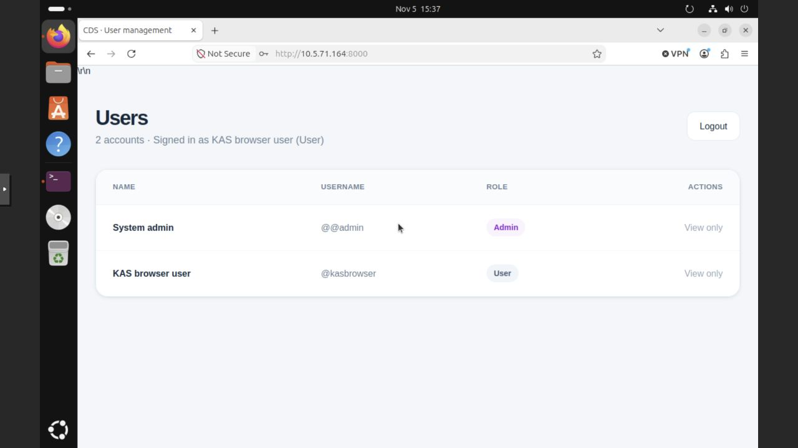

*User: all rows are read-only; creation, editing and deletion are unavailable.*

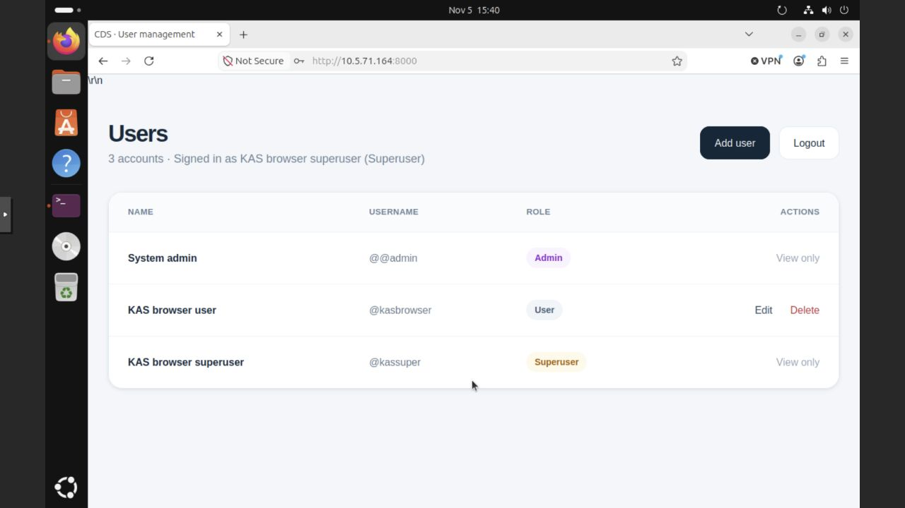

*Superuser: ordinary accounts are editable; privileged accounts remain read-only.*

The shared dashboard changes its available actions by role. Additional browser evidence records a successful [superuser edit](screenshots/academy/03-firefox-role-tests/04-superuser-edit.jpg) and [deletion](screenshots/academy/03-firefox-role-tests/05-superuser-delete.jpg). The admin removed the remaining temporary account after testing; cleanup is also verified in the API results.

### Security choices and alternatives

| Choice | Reason and alternative |
| --- | --- |
| BCrypt | Provides salted, deliberately expensive password hashing through a maintained library. Argon2id is an alternative with configurable memory cost; fast unsalted hashes such as SHA-256 alone are unsuitable for passwords. |
| JWT plus a database account check | Fits the API and permits immediate permission/account changes. Server-side sessions would make central revocation more direct, at the cost of session storage; an identity provider could add MFA and managed account recovery. |
| ASP.NET authentication and EF Core | Uses framework validation and parameterized queries instead of custom token parsing or SQL assembled from form fields. The manual first-admin bootstrap is confined to the test setup. |
| Same-origin Nginx proxy | Avoids a browser dependency on a separate API hostname. The backend currently allows any CORS origin; a company deployment should remove this policy or restrict it to approved origins. CORS is not an authorization control. |

For company use, add HTTPS, replace the test admin, enforce password rules in the API, add login rate limits/MFA, restrict database exposure and Swagger, and test backups. The UI requires eight characters for a new password, while the API only requires a nonempty value. Startup should reject missing/weak JWT secrets; deployment should use pinned images, monitoring and controlled restarts.

### Build and run

Docker with Compose is required. Run these commands from a fresh clone's root directory on Ubuntu:

```sh
git clone https://github.com/zsaamu/cds-compulsory-assignment.git
cd cds-compulsory-assignment
umask 077
printf 'JWT_KEY=%s\nPOSTGRES_PASSWORD=%s\n' \
  "$(openssl rand -hex 32)" "$(openssl rand -hex 24)" > .env
docker compose up --build -d --wait
docker compose ps
```

The generated `.env` supplies `JWT_KEY` and `POSTGRES_PASSWORD` and is ignored by Git. Preserve existing secrets/volumes when resuming a server. Changing the `.env` database password does not update an initialized database. Prefix Docker commands with `sudo` if your Ubuntu account lacks Docker access.

Remove any old `VITE_API_URL` override before building. The Docker frontend uses same-origin requests; Nginx preserves `/api/Auth/...` when forwarding to `backend:8080`.

On a fresh database, open PostgreSQL:

```sh
docker compose exec postgres psql -U admin -d kvist_db
```

Create the first admin once:

```sql
INSERT INTO "Users" ("Fullname", "Username", "PasswordHash", "Role")
VALUES ('System Admin', '@admin', '$2a$11$JkBFAUgXsNma2OWzqtTQkOXVsiHTCRpYyRQ3/YX8armgq4nmqWKbC', 'admin');
```

Exit with `\q`. Log in with test credentials `@admin` / `password`; use lowercase `admin` for the role. The SQL stores the BCrypt hash. Create other roles through the UI and replace this public test credential before company use.

| Location | Application | Swagger |
| --- | --- | --- |
| Server itself | `http://localhost:8000` | `http://localhost:8000/swagger` |
| Academy client, recorded lease | `http://10.5.71.164:8000` | `http://10.5.71.164:8000/swagger` |

For another installation, replace the IP with that server's address. In Swagger, call `POST /api/Auth/login`, copy the returned token, click **Authorize**, and paste the token without an extra `Bearer` prefix.

PostgreSQL data persists in `pgdata`. `docker compose down` preserves it; adding `-v` deletes it. After a VM reboot, run `docker compose up -d --wait --pull never --no-build` from the existing checkout because no restart policy is configured. Compose checks database health but only process state for the other services: allow a few seconds for API readiness if Nginx briefly returns 502. The deprecated Compose `version` warning is informational.

### Application tests

On 5 November, the academy API suite passed 41/41 checks and passed again after the network repair and VM restart. A separate build of main application commit `81e1227`, with a fresh local database, passed 41 API, 15 browser and 6 BCrypt/persistence/restart checks. These 62 local checks supplement the actual academy network and Firefox evidence.

| Area | Verified result |
| --- | --- |
| Authentication | All three roles log in; wrong passwords and anonymous protected requests are rejected. |
| Password confidentiality | User responses omit hashes; account passwords are hashed by BCrypt. |
| Ordinary user | Reads the table; create/edit/delete requests are rejected. |
| Superuser | Creates, reads, edits and deletes ordinary users; privileged operations and role promotion are rejected. |
| Admin | Creates accounts in all three roles, edits privileged accounts, changes roles and deletes accounts. |
| Existing sessions | Demoted admin loses write access; deleted accounts' tokens are rejected. |
| Cleanup | Temporary test accounts removed and original admin remains usable. |

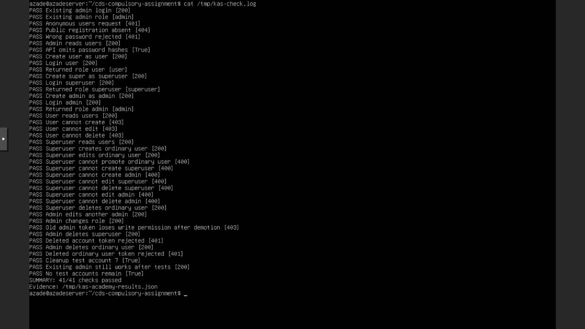

Local test records: [41 API checks](evidence/main-api-results.json), [15 browser checks](evidence/main-browser-results.json), and [6 hashing/restart checks](evidence/main-hashing-and-restart-results.json). The application code matches main commit `81e1227`; the report and images do not change application behavior.

The network evidence below shows the academy retest. API checks cover prohibited actions as well as the operations demonstrated in Firefox.

## CDS.infrastructure

### Company network plan

The company proposal covers all devices in the brief: 15 desktops, 10 laptops, 3 printers, 3 servers, 12 phones, 4 access points, 6 cameras, network equipment and variable guest devices. Guest sizing assumes 100 concurrent devices because the brief gives no count.

VLANs 570 and 571 and their /24 networks are assigned by the brief. Their gateways match the academy's observed `.5` addresses. VLANs 572-576 and all company allocations are design choices. Only the two academy VM networks are implemented; the final lab settings are recorded separately below.

#### Proposed subnets

Each VLAN uses a separate private subnet within `10.0.0.0/8` and a router/firewall gateway. Usable counts exclude network and broadcast addresses; the gateway takes one host address.

| VLAN | Group and current demand | Network/CIDR | Subnet mask | Proposed gateway | Usable addresses |
| --- | --- | --- | --- | --- | --- |
| 570 | Employees: 15 desktops + 10 laptops | 10.5.70.0/24 | 255.255.255.0 | 10.5.70.5 | 254 |
| 571 | Servers: 3 | 10.5.71.0/24 | 255.255.255.0 | 10.5.71.5 | 254 |
| 572 | Printers: 3 | 10.5.72.0/28 | 255.255.255.240 | 10.5.72.1 | 14 |
| 573 | IP phones: 12 | 10.5.73.0/27 | 255.255.255.224 | 10.5.73.1 | 30 |
| 574 | Cameras: 6 | 10.5.74.0/28 | 255.255.255.240 | 10.5.74.1 | 14 |
| 575 | Management: 4 access points + network equipment | 10.5.75.0/27 | 255.255.255.224 | 10.5.75.1 | 30 |
| 576 | Guests: variable; sizing assumption of 100 | 10.5.76.0/24 | 255.255.255.0 | 10.5.76.1 | 254 |

#### Address allocation and growth

Servers and shared equipment use static addresses. Employee computers, phones and guests use DHCP. Gateways and static addresses stay outside the DHCP pools.

| VLAN | Proposed device allocation | Growth capacity |
| --- | --- | --- |
| 570 | DHCP: 10.5.70.50-10.5.70.199 | Pool supports 150 computers, compared with 25 today. Other host addresses remain reserved. |
| 571 | Static servers: 10.5.71.10-10.5.71.12; application server proposed at 10.5.71.10 | 253 device addresses after the gateway. Keep the assignment's /24 even though three servers need much less space. |
| 572 | Static printers: 10.5.72.2-10.5.72.4 | 13 device addresses after the gateway; room for 10 additional printers. |
| 573 | DHCP: 10.5.73.2-10.5.73.30 | Pool supports 29 phones; room for 17 additional phones. |
| 574 | Static cameras: 10.5.74.2-10.5.74.7 | 13 device addresses after the gateway; room for 7 additional cameras. |
| 575 | Static access points: 10.5.75.2-10.5.75.5; switches and other management interfaces: 10.5.75.6-10.5.75.30 | 29 device addresses after the gateway, including the 4 access points. Size the final equipment order within this capacity; expand the management subnet if more than 25 additional interfaces are needed. |
| 576 | DHCP: 10.5.76.20-10.5.76.219 | Pool supports 200 guests, leaving 100 spare leases above the sizing assumption. |

Company DHCP scopes supply the gateway and DNS resolver. This proposal uses `10.5.71.5` for internal DNS, with UDP/TCP 53 permitted to it. Guest DHCP supplies an approved public resolver, with internal access blocked. These are design choices, not tests of every academy segment.

The planned employee pool `.50-.199` and server range `.10-.12` differ from the academy DHCP leases `.233` and `.164`. A company application server needs a reserved or coordinated static address. Unallocated addresses allow growth; revise the subnet/scope before capacity is exceeded.

#### Segmentation and access

Employees, servers, printers, phones and cameras have different access needs. Management interfaces are isolated from everyday traffic. The four VLAN-capable access points have management addresses in VLAN 575 and carry separate employee (570) and guest (576) SSIDs. The 10 laptops are already included in the 25 employee computers.

The proposed firewall allows required services: employee access to the login platform and printers, authorized access to cameras and administration from an approved management workstation. Guests receive Internet access only. Confirm business-service ports before implementation. Switch sizing must include device ports, PoE, uplinks and growth.

#### Subnetting examples

| Example | Network | Mask | Usable host range | Broadcast | Calculation |
| --- | --- | --- | --- | --- | --- |
| Employees | 10.5.70.0/24 | 255.255.255.0 | 10.5.70.1-10.5.70.254 | 10.5.70.255 | 2^(32-24) - 2 = 254 usable addresses |
| IP phones | 10.5.73.0/27 | 255.255.255.224 | 10.5.73.1-10.5.73.30 | 10.5.73.31 | 2^(32-27) - 2 = 30 usable addresses |

The assigned employee /24 leaves 253 device addresses after the gateway, well above the 25 computers; its DHCP pool provides 150 leases. The phone /27 provides 29 device addresses after its gateway, enough for 12 phones plus 17 more. A /28 would allow only one additional phone.

#### Company network diagram

The proposed router/firewall provides segment gateways, permitted inter-VLAN routing and Internet access. The managed switch carries the VLANs. Connections below do not imply unrestricted access.

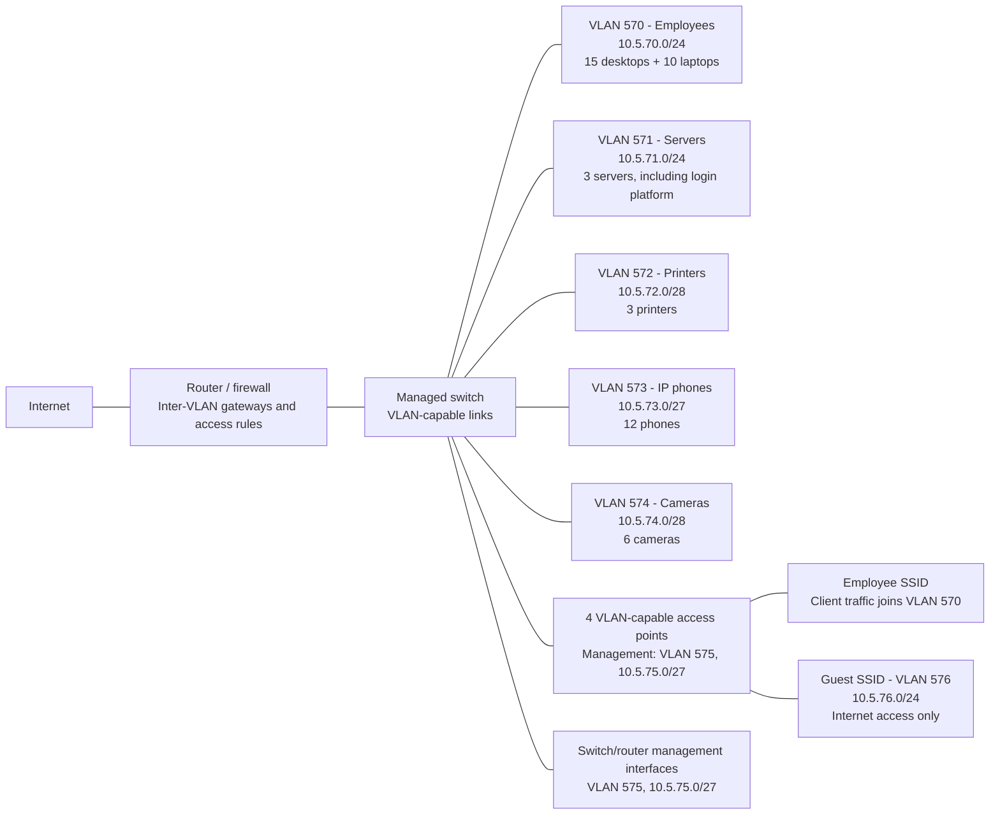

### Implemented academy environment

The implemented lab uses two VMs on Proxmox node `pve02` (management `10.5.70.12/24`, gateway `10.5.70.5`). Final settings were recorded on 5 November.

| Setting | Server | Client |
| --- | --- | --- |
| VM | 101, `Azade-kas` | 115, `client-ubuntu-desktop` |
| OS | Ubuntu Server; `hostnamectl` reported Ubuntu 26.04.1 LTS | Ubuntu Desktop; installed root filesystem `/dev/sda2`, ext4 |
| Hostname / interface | `azadeserver` / `ens18` | `kas-Standard-PC-i440FX-PIIX-1996` / `ens18` |
| Address | `10.5.71.164/24`, DHCP | `10.5.70.233/24`, DHCP |
| Gateway and DNS | `10.5.71.5` | `10.5.70.5` |
| VM network device | VirtIO, MAC `BC:24:11:5E:1A:5D` | VirtIO, MAC `BC:24:11:39:70:59` |
| Saved attachment | Existing SDN VNet `VLAN571`, no additional VM tag | `vmbr0`, no explicit VM tag |
| Proxmox adapter firewall flag | Enabled | Enabled |
| Gateway check | 3/3 replies, 0% loss | 3/3 replies, 0% loss |

The existing VNet `VLAN571` (alias `Servers`) applies tag 571. The client receives the assigned client subnet through untagged `vmbr0`; the physical switch/native VLAN mapping was not independently inspected. Both IPs are DHCP leases: recheck them with `ip -br address` before a demonstration.

#### Client installation and installed disk

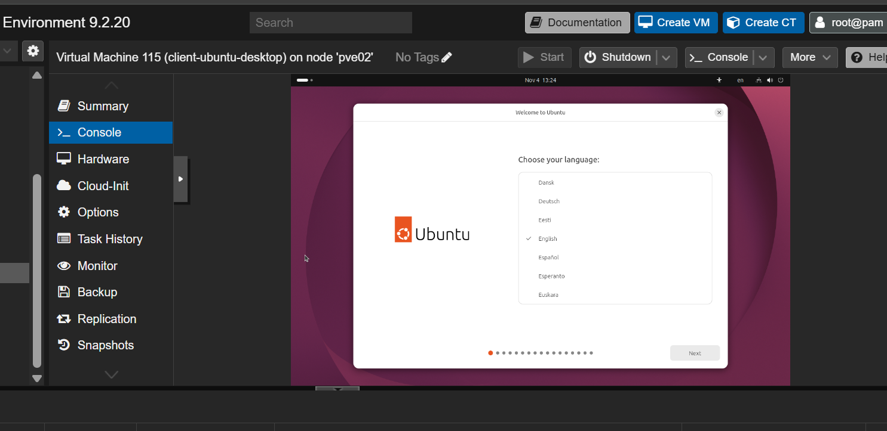

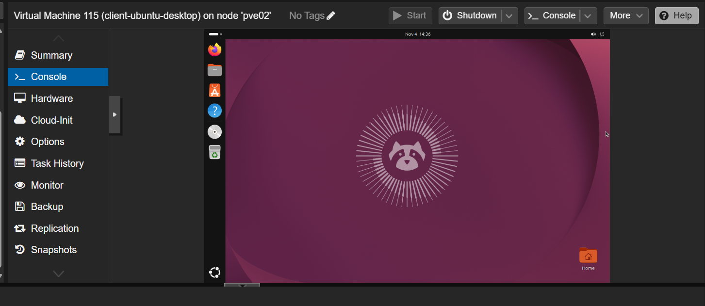

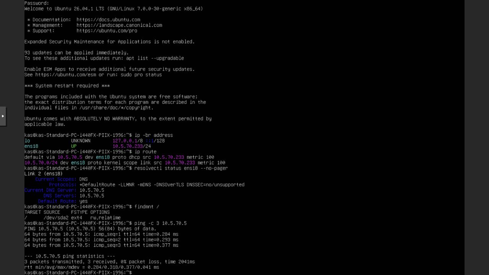

Installation stages, running desktop and the installed root disk are shown above.

### Ubuntu Server and Docker deployment

Azade installed Ubuntu Server in VM 101 (`azadeserver`), with two CPU cores, 4 GiB RAM and a 32 GiB virtual disk. She installed Docker Engine and the Compose plugin from Docker's Ubuntu package repository and verified them with `sudo docker run hello-world`. Recorded versions are Docker 29.9.2 and Compose v5.6.1.

#### Ubuntu Server and Docker installation evidence from Azade

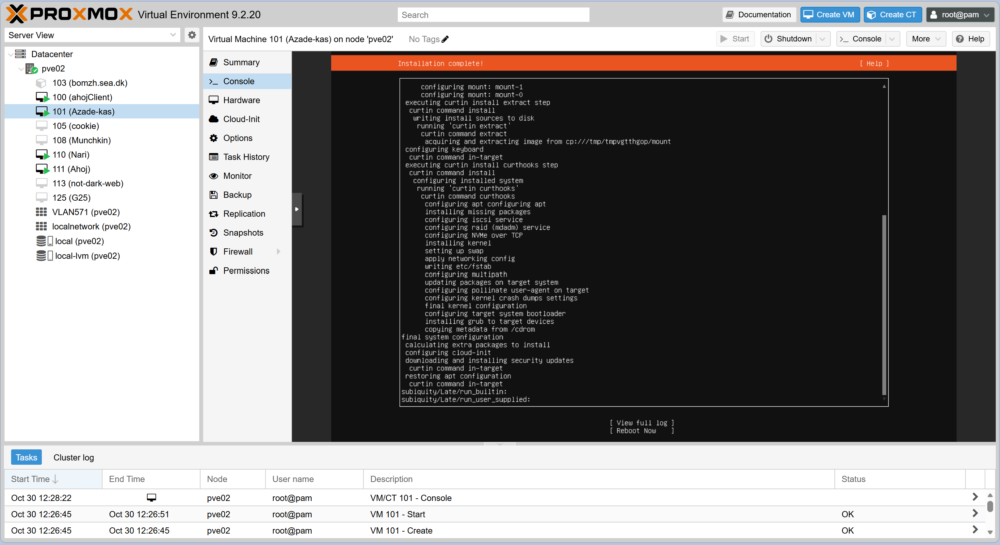

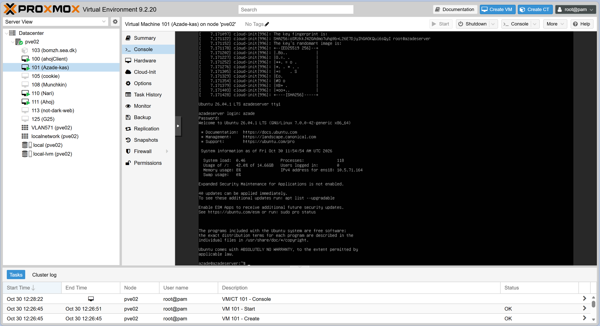

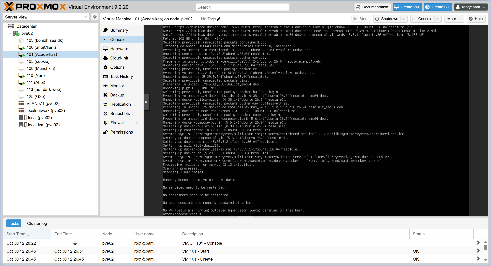

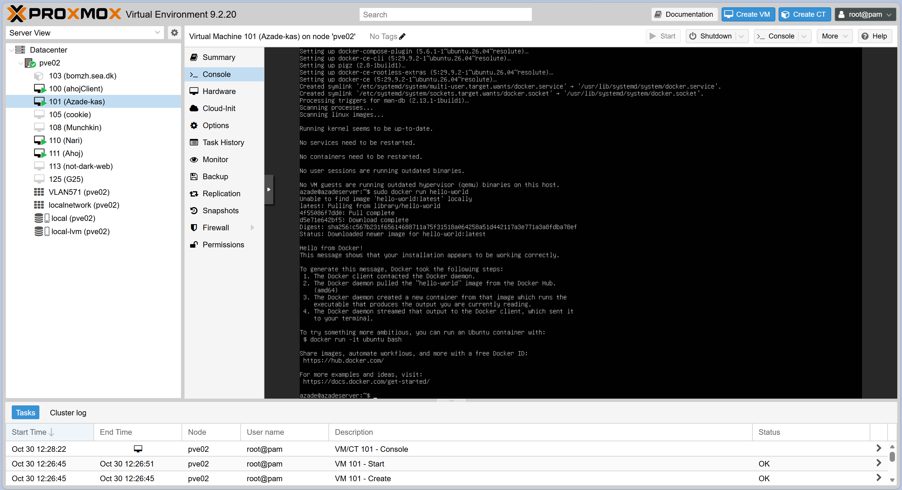

These screenshots record the initial installation on 30 October. Use the final VM/network table above for the configuration verified on 5 November.

The group deployed checkout `81e1227` using the setup steps in CDS.security. PostgreSQL creates the database; the API's `EnsureCreated` creates its schema. Before role testing, the test admin password was restored and its role corrected from `Admin` to lowercase `admin`. Existing secrets and data were preserved.

| Service | Container | Connection |
| --- | --- | --- |
| Nginx / React | `kvist_frontend` | Server TCP 8000 -> container TCP 80 |
| ASP.NET Core API | `kvist_backend` | Docker service `backend:8080`, reached through Nginx |
| PostgreSQL 15 Alpine | `kvist_postgres` | `postgres:5432`, persistent `pgdata`; Compose also publishes host TCP 5432 |

Port **8000** is within the assignment's allowed TCP 8000-8100 range. PostgreSQL's host-published port is unnecessary for browser access and should be removed/restricted for company use.

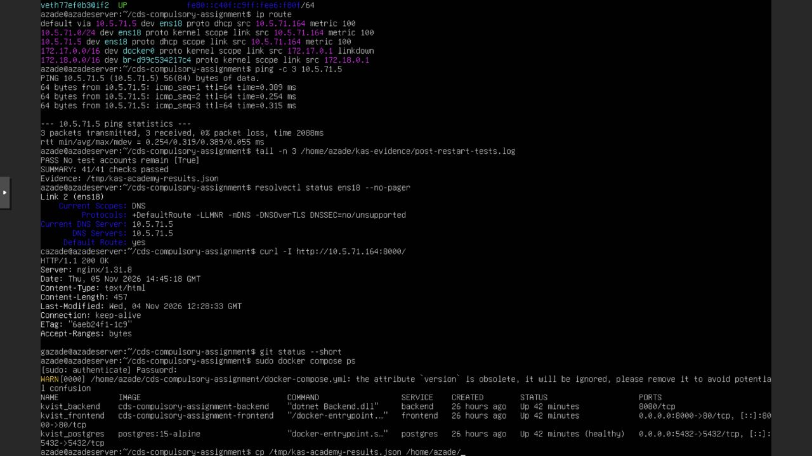

### Lab communication diagram

The tested academy path is shown below; all three containers run inside server VM 101.

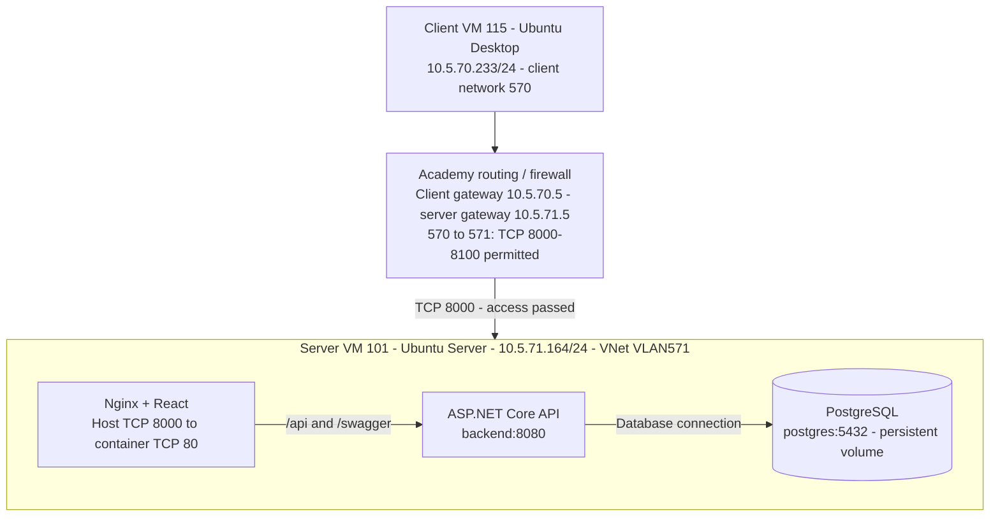

PostgreSQL's host port 5432 is outside the tested browser path. Gateway labels describe logical routing roles.

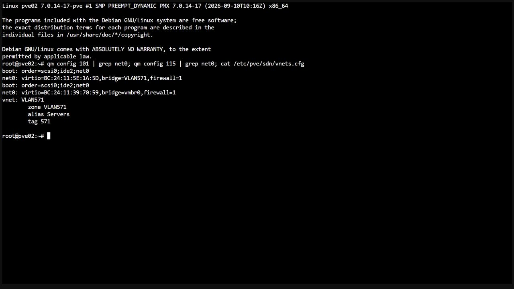

### Why routing and port restrictions matter

VLANs separate Layer 2 broadcast domains. The client and server are in different /24 subnets, so they send traffic through gateways rather than resolving each other's MAC directly. Routing forwards traffic between networks; the firewall controls which services may cross. Account permissions remain the API's responsibility.

The assignment's existing firewall permits client VLAN 570 -> server VLAN 571 on TCP 8000-8100. We changed no shared firewall rules and tested port 8000. Limiting ports reduces exposure of unrelated services; this test does not establish access on other ports or in the reverse direction.

### Connectivity and deployment evidence

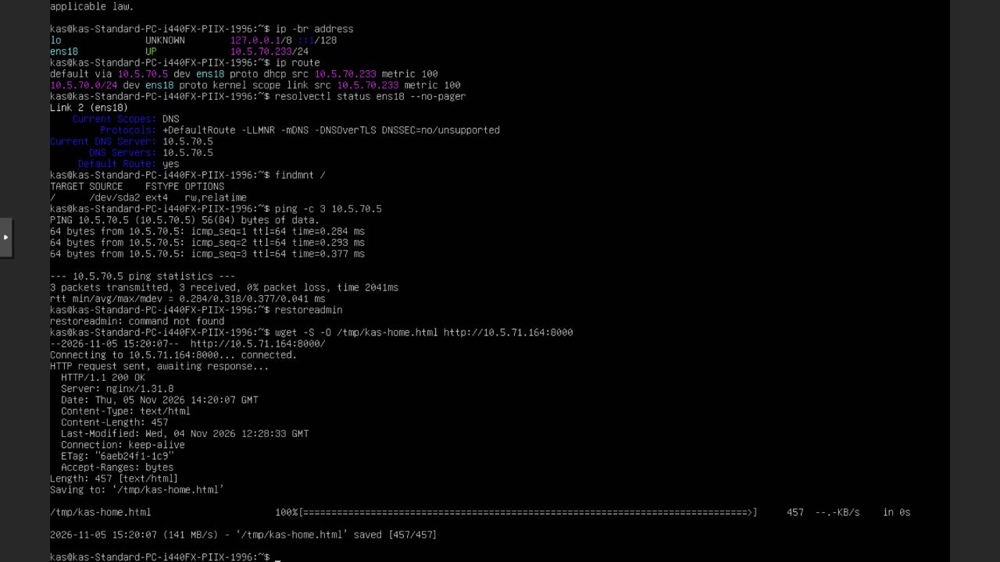

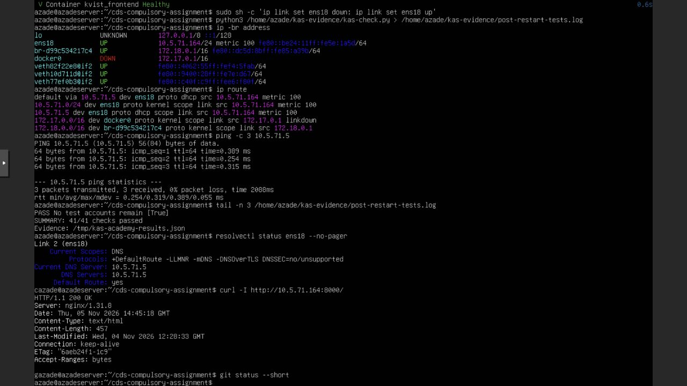

| Academy check | Final result on 5 November |
| --- | --- |
| Correct server and client subnet, routes and DNS | Recorded in the configuration table and screenshots. |
| Server and client gateway connectivity | Both passed, 3 replies from 3 requests. |
| Client -> `http://10.5.71.164:8000` | HTTP 200 and application displayed in Firefox. |
| Browser functionality | Admin account creation; ordinary-user read-only view; superuser edit/delete of an ordinary account; admin cleanup passed. |
| API role/session regression after restart | 41/41 passed, including prohibited actions. |
| Container state and data | Three services running; PostgreSQL healthy; temporary accounts removed. |

The CDS.security Firefox screenshots demonstrate these operations from client VM 115.

### Challenges and resolution

| Problem | Investigation and resolution |
| --- | --- |
| Proxmox bridge dropdown unavailable | Azade reported a connection error in the bridge selector. Refreshing Proxmox restored the list and allowed initial VM creation. The final server attachment is the VNet documented above. |
| Client received a link-local address or no lease | A manually tried gateway `.1` was unverified. The working saved client attachment is untagged `vmbr0`; DHCP supplied `10.5.70.233/24`, gateway and DNS `10.5.70.5`. Gateway connectivity then passed. |
| Server could serve locally but client could not connect | The former server address was `.165`. Its gateway neighbour resolution failed, and later the guest had no IPv4 lease. Initial inspection found its live uplink peer detached from a bridge. Restarting only VM 101 restored attachment but DHCP still failed on `vmbr0` with explicit tag 571. |
| DHCP offers reached the host but not the server VM | MAC-filtered captures saw offers at the physical uplink while the guest saw requests without offers. We connected only VM 101 to the existing SDN VNet `VLAN571`, without an extra adapter tag. DHCP then supplied `.164`, the gateway replied and client access worked. |
| First admin could not complete the required login/authorization flow | Confirmed the intended test credentials, restored the test password hash and corrected the role's case. Login and all role checks then passed. |
| Frontend/backend integration and API path | The Docker frontend uses an empty default API base URL. Nginx preserves `/api/Auth/...` instead of adding or removing a second `/api` prefix. |

The evidence supports a VM attachment/path mismatch; the exact underlying cause was not established. No shared bridge, SDN definition, switch or network firewall configuration was changed. The successful final tests supersede the initial failures.

## Final reflection

Security and infrastructure depend on each other: the platform needs both a reachable service and backend account permissions. BCrypt protects stored passwords, JWT authenticates requests, current database roles control actions, and VLAN/firewall rules limit network access.

The main challenge was separating a working local service from a broken routed connection. IP, route, neighbour and DHCP checks identified the VM attachment problem; gateway, HTTP, browser and API retests confirmed the repair. The bootstrap problem also showed the need for reproducible setup and consistent role names. Without remote lab access, infrastructure work and its evidence had to be collected at the academy.

For a real company, we would reserve server addresses, use internal DNS and HTTPS, strengthen account policies and secrets handling, restrict database/management access, and add monitoring, controlled restarts and tested backups. Pinned, maintained dependencies would make deployment more predictable.

Assignment source: *Compulsory-assignment.pdf*, Kvist & Bjælke ApS, pages 2-9. This README contains the combined report; screenshots support the text, tables and diagrams.
