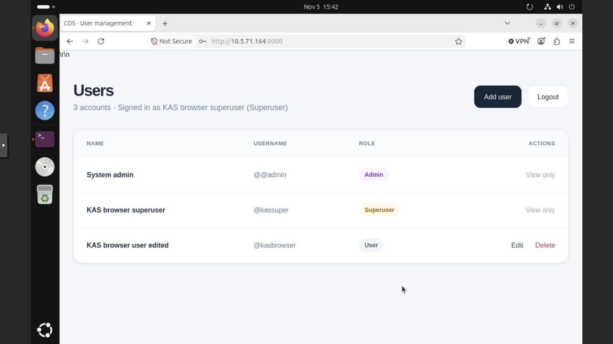
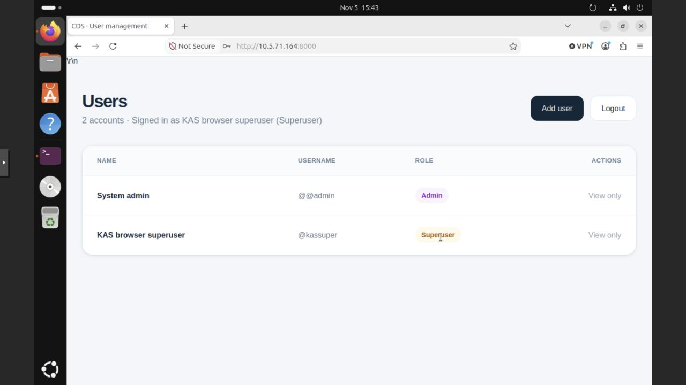
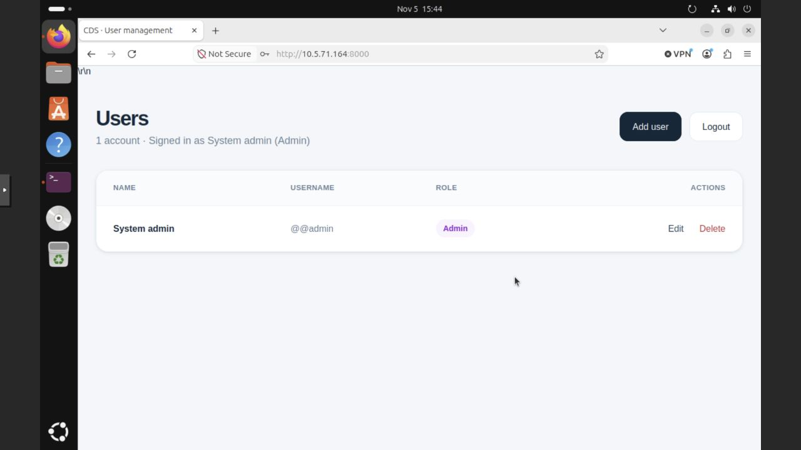
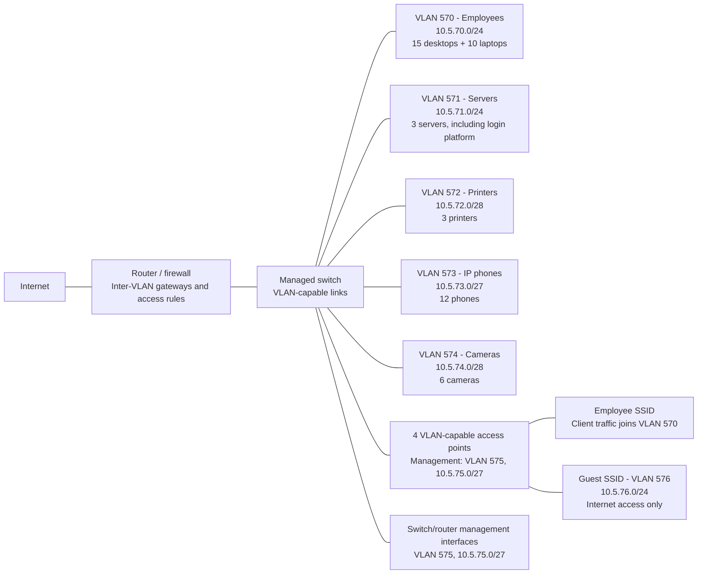
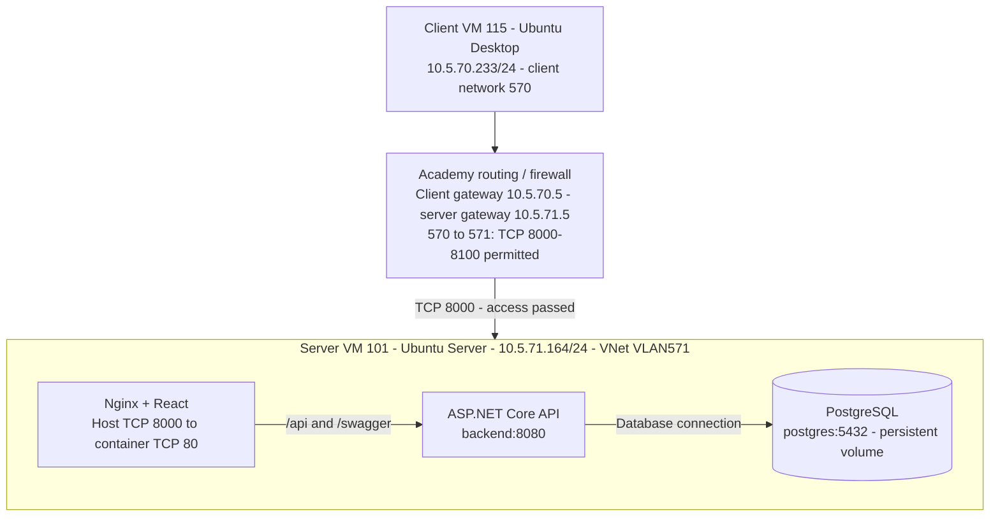
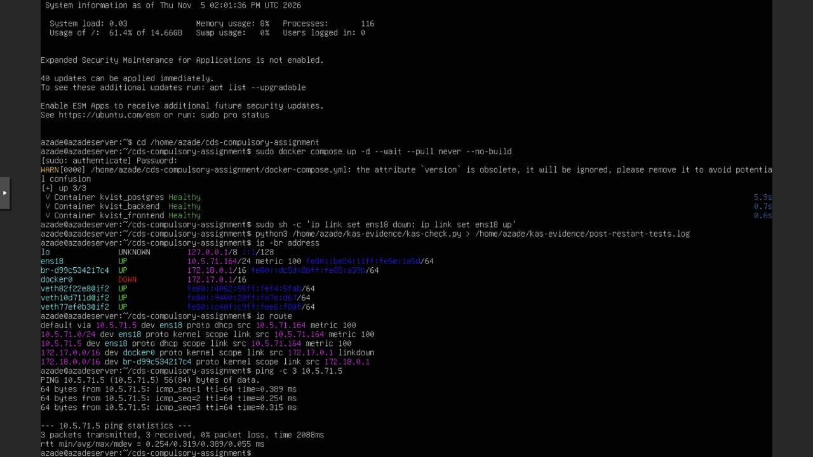

# KAS: CDS Security & Infrastructure

Login and user management platform for **Kvist & Bjælke ApS**. This README is the combined report for CDS.security and CDS.infrastructure. The source code is available in [this repository](https://github.com/zsaamu/cds-compulsory-assignment).

The application was deployed on Ubuntu Server in Proxmox and accessed from a separate Ubuntu Desktop VM. On 5 November 2026, client-to-server access, browser operations for all three roles and 41 API checks passed. The final recorded academy URL is `http://10.5.71.164:8000`; the server address is a DHCP lease.

## Contents

- [Team and work completed](#team-and-work-completed)
- [CDS.security](#cdssecurity)
- [CDS.infrastructure](#cdsinfrastructure)
- [Final reflection](#final-reflection)

## Team and work completed

| Member | Contribution |
| --- | --- |
| Samuele ([zsaamu](https://github.com/zsaamu)) | Repository coordination, company IP plan, diagrams, deployment verification, network troubleshooting, testing and combined report. |
| Kyrylo ([Kyrylo-Vorona](https://github.com/Kyrylo-Vorona)) | PostgreSQL data model, backend authentication, BCrypt, JWT, role authorization, Docker setup and academy deployment/client configuration. |
| Azade ([azade1416](https://github.com/azade1416)) | React frontend, login form, role-aware account management, frontend documentation and initial academy server VM setup. |

| Period (2026) | Work completed |
| --- | --- |
| 26-28 October | Repository and responsibilities established; backend and frontend developed, integrated and tested; unused registration DTO removed. |
| 29-30 October | Full Docker deployment and same-origin API routing completed and merged. |
| 2-4 November | Company addressing plan and diagrams drafted; academy server deployed and Ubuntu Desktop client prepared. Initial cross-subnet access failed. |
| 5 November | Server VM attachment corrected; DHCP and gateway connectivity restored; client browser and API tests completed; final evidence and report assembled. |

The [issues](https://github.com/zsaamu/cds-compulsory-assignment/issues) and [project board](https://github.com/users/zsaamu/projects/3/views/1) record task ownership. The dates above describe completed work rather than planned deadlines.

## CDS.security

### Platform and technology choices

The platform has a login form, a shared user table and an account dialog. The dashboard offers actions according to the signed-in role. React and TypeScript keep the interface in small components and give the frontend explicit account and role types. The browser sends JSON requests to an ASP.NET Core (.NET 10) API, which handles authentication, validation and authorization. Entity Framework Core accesses PostgreSQL through Npgsql.

Nginx serves the compiled frontend and forwards `/api/` and `/swagger` to the backend. This same-origin setup lets the browser use the current server address without a hardcoded localhost API URL. Docker Compose runs frontend, backend and database as three services, with a persistent PostgreSQL volume. The API requires the database during startup and waits for PostgreSQL's health check through Compose.


### Password handling and authentication

`AuthController` hashes new passwords using BCrypt.Net-Next 4.0.3 and verifies a submitted password with `BCrypt.Verify`. BCrypt generates a salt and stores the salt, cost and hash in the resulting string. This slows offline guessing and means identical passwords can have different stored hashes. A stolen hash can still be attacked; hashing does not make a weak password safe.

The database stores `Id`, `Fullname`, `Username`, `PasswordHash` and `Role`. User-list responses include account details and roles but omit password hashes. Passwords are accepted for login/account creation and are never returned by the API or stored as plaintext user records. Plaintext passwords still exist briefly in the submitted request; the academy deployment uses HTTP, so transport encryption is a separate production requirement.

On successful login, `TokenService` issues an HMAC-SHA256 signed JWT containing account ID, username and role, with a three-hour expiry. ASP.NET validates signature, issuer, audience and lifetime. The frontend keeps the token in React memory and sends it as `Authorization: Bearer <token>`; refreshing the page requires a new login. A signed JWT is not encrypted, so the payload contains no password.

Each protected account endpoint also retrieves the current account from PostgreSQL. Authorization uses that current database role: demotion removes write permission even when the old JWT still contains an admin claim, and deleting an account makes its existing token unusable. Public registration is absent; authorized accounts create users.

### Authorization and interface

| Operation | User | Superuser | Admin |
| --- | --- | --- | --- |
| Read account details and roles | Yes | Yes | Yes |
| Create, edit and delete ordinary users | No | Yes | Yes |
| Create, edit and delete superusers/admins | No | No | Yes |
| Assign a privileged role | No | No | Yes |

The backend enforces these rules independently of visible buttons. A user attempting a write receives HTTP 403. A superuser attempting a privileged account operation receives HTTP 400 with an explanation. Missing/invalid authentication receives HTTP 401. The UI hides ordinary-user write controls, limits the superuser role selector to `user`, and makes privileged rows read-only for superusers.

The following screenshots were taken in Firefox inside academy client VM 115, using the deployed server address.


*Admin session and account table, reached from the client VM.*


*The ordinary user sees the table without account-management actions.*


*The superuser can manage ordinary users; privileged accounts remain read-only.*

<details>
<summary>Successful superuser changes and test-account cleanup</summary>







The admin created the browser test accounts. The superuser edited and deleted an ordinary account, then the admin removed the temporary superuser. Only the original admin remained.

</details>

### Security choices and alternatives

| Choice | Reason and alternative |
| --- | --- |
| BCrypt | Provides salted, deliberately expensive password hashing through a maintained library. Argon2id is an alternative with configurable memory cost; fast unsalted hashes such as SHA-256 alone are unsuitable for passwords. |
| JWT plus a database account check | Fits the API and permits immediate permission/account changes. Server-side sessions would make central revocation more direct, at the cost of session storage; an identity provider could add MFA and managed account recovery. |
| ASP.NET authentication and EF Core | Uses framework validation and parameterized queries instead of custom token parsing or SQL assembled from form fields. The manual first-admin bootstrap is confined to the test setup. |
| Same-origin Nginx proxy | Avoids a browser dependency on a separate API hostname. The backend currently allows any CORS origin; a company deployment should remove this policy or restrict it to approved origins. CORS is not an authorization control. |

The implemented solution meets the assignment's login, hashing and role requirements, but it is a teaching deployment. Before company use, add HTTPS, replace the documented test admin, enforce password rules in the API as well as the UI, add login rate limits/MFA as appropriate, restrict database exposure and Swagger, and introduce audited backups and recovery. The current UI enforces an eight-character minimum on account creation; the API only requires a nonempty password. The JWT secret is supplied through `.env`; startup should also reject missing/weak secrets explicitly rather than relying on the current configuration. Docker images should be pinned, updated and monitored.

### Build and run

Docker with Compose is required. Run these commands from a fresh clone's root directory on Ubuntu:

```sh
git clone https://github.com/zsaamu/cds-compulsory-assignment.git
cd cds-compulsory-assignment
umask 077
printf 'JWT_KEY=%s\nPOSTGRES_PASSWORD=%s\n' \
  "$(openssl rand -hex 32)" "$(openssl rand -hex 24)" > .env
docker compose up --build -d --wait
docker compose ps
```

The generated `.env` has exactly the required `JWT_KEY` and `POSTGRES_PASSWORD` values and is ignored by Git. Keep existing deployment secrets and database volumes when resuming a server; do not regenerate the database password for an initialized volume. Ubuntu users without Docker group membership must prefix Docker commands with `sudo`.

No `VITE_API_URL` is required for Docker. Remove an old override before building so the frontend keeps its same-origin default. Nginx preserves the `/api/Auth/...` path when proxying to `backend:8080`.

On a fresh database, open PostgreSQL:

```sh
docker compose exec postgres psql -U admin -d kvist_db
```

Create the first admin once:

```sql
INSERT INTO "Users" ("Fullname", "Username", "PasswordHash", "Role")
VALUES ('System Admin', '@admin', '$2a$11$JkBFAUgXsNma2OWzqtTQkOXVsiHTCRpYyRQ3/YX8armgq4nmqWKbC', 'admin');
```

Exit with `\q`. The reproducible local demonstration login is `@admin` / `password`; this is a deliberately documented test credential, not a company account. The role must be lowercase `admin`. The SQL stores the BCrypt hash, not the plaintext password. Create separate accounts through the UI to demonstrate each role.

| Location | Application | Swagger |
| --- | --- | --- |
| Server itself | `http://localhost:8000` | `http://localhost:8000/swagger` |
| Academy client, recorded lease | `http://10.5.71.164:8000` | `http://10.5.71.164:8000/swagger` |

For another installation, replace the IP with that server's address. In Swagger, call `POST /api/Auth/login`, copy the returned token, click **Authorize**, and paste the token without an extra `Bearer` prefix.

Compose keeps PostgreSQL data in `pgdata`. `docker compose down` stops the services while preserving this volume; `down -v` deletes it and is not a normal restart step. No restart policy is configured, so after a VM reboot run `docker compose up -d --wait --pull never --no-build` from the existing checkout. Compose waits for the PostgreSQL health check but only checks that the other service processes are running. Allow a few seconds for the API to accept requests; a brief HTTP 502 during startup is not a completed readiness check. The deprecated Compose `version` warning is informational.

### Application tests

On 5 November, the academy API suite passed 41/41 checks, then passed 41/41 again after the network repair and VM restart. The final submission check independently rebuilt `main` commit `81e1227` with a fresh local database and repeated the same suite successfully. The API checks run through Nginx on port 8000; they are separate from the actual academy cross-subnet browser tests. A further 15 browser checks and 6 hashing/restart checks passed on the isolated local main build. Those 62 local checks supplement the academy evidence rather than replacing it.

| Area | Verified result |
| --- | --- |
| Authentication | All three roles log in; wrong passwords and anonymous protected requests are rejected. |
| Password confidentiality | User responses omit hashes; account passwords are hashed by BCrypt. |
| Ordinary user | Reads the table; create/edit/delete requests are rejected. |
| Superuser | Creates, reads, edits and deletes ordinary users; privileged operations and role promotion are rejected. |
| Admin | Creates accounts in all three roles, edits privileged accounts, changes roles and deletes accounts. |
| Existing sessions | Demoted admin loses write access; deleted accounts' tokens are rejected. |
| Cleanup | Temporary test accounts removed and original admin remains usable. |


Local test records: [41 API checks](evidence/main-api-results.json), [15 browser checks](evidence/main-browser-results.json), and [6 hashing/restart checks](evidence/main-hashing-and-restart-results.json). The application code matches main commit `81e1227`; the report and images do not change application behavior.

The final repeat is visible with the server network evidence below. Browser checks demonstrate the interface; API checks also cover actions that the interface intentionally does not offer.

## CDS.infrastructure

### Company network plan

The tables below define the proposed company design. The assignment fixes VLANs 570 and 571 and their /24 networks. Their proposed gateways use the .5 addresses confirmed during the academy deployment. VLANs 572-576, their gateways, and all company device allocations are design choices. Only the server and client networks are implemented for the assignment; the remaining segments describe the company proposal. The lab record below reports actual settings and test results separately.

The inventory contains 15 desktops, 10 laptops, 3 printers, 3 servers, 12 IP phones, 4 access points, 6 cameras, network equipment as required, and a variable number of guest devices. The employee network therefore starts with 25 computers. For sizing only, this plan assumes up to 100 concurrent guest devices; the brief does not specify a guest count.

#### Proposed subnets

All addresses use the private 10.0.0.0/8 range. Each VLAN has a separate subnet and a gateway interface on the router/firewall. Usable addresses exclude the network and broadcast addresses; the gateway consumes one usable address.

| VLAN | Group and current demand | Network/CIDR | Subnet mask | Proposed gateway | Usable addresses |
| --- | --- | --- | --- | --- | --- |
| 570 | Employees: 15 desktops + 10 laptops | 10.5.70.0/24 | 255.255.255.0 | 10.5.70.5 | 254 |
| 571 | Servers: 3 | 10.5.71.0/24 | 255.255.255.0 | 10.5.71.5 | 254 |
| 572 | Printers: 3 | 10.5.72.0/28 | 255.255.255.240 | 10.5.72.1 | 14 |
| 573 | IP phones: 12 | 10.5.73.0/27 | 255.255.255.224 | 10.5.73.1 | 30 |
| 574 | Cameras: 6 | 10.5.74.0/28 | 255.255.255.240 | 10.5.74.1 | 14 |
| 575 | Management: 4 access points + network equipment | 10.5.75.0/27 | 255.255.255.224 | 10.5.75.1 | 30 |
| 576 | Guests: variable; sizing assumption of 100 | 10.5.76.0/24 | 255.255.255.0 | 10.5.76.1 | 254 |

#### Address allocation and growth

Static addresses keep servers and shared equipment reachable at a stable address. DHCP assigns addresses automatically to employee computers, phones, and guests. Fixed addresses and gateways are outside the DHCP pools.

| VLAN | Proposed device allocation | Growth capacity |
| --- | --- | --- |
| 570 | DHCP: 10.5.70.50-10.5.70.199 | Pool supports 150 computers, compared with 25 today. Other host addresses remain reserved. |
| 571 | Static servers: 10.5.71.10-10.5.71.12; application server proposed at 10.5.71.10 | 253 device addresses after the gateway. Keep the assignment's /24 even though three servers need much less space. |
| 572 | Static printers: 10.5.72.2-10.5.72.4 | 13 device addresses after the gateway; room for 10 additional printers. |
| 573 | DHCP: 10.5.73.2-10.5.73.30 | Pool supports 29 phones; room for 17 additional phones. |
| 574 | Static cameras: 10.5.74.2-10.5.74.7 | 13 device addresses after the gateway; room for 7 additional cameras. |
| 575 | Static access points: 10.5.75.2-10.5.75.5; switches and other management interfaces: 10.5.75.6-10.5.75.30 | 29 device addresses after the gateway, including the 4 access points. Size the final equipment order within this capacity; expand the management subnet if more than 25 additional interfaces are needed. |
| 576 | DHCP: 10.5.76.20-10.5.76.219 | Pool supports 200 guests, leaving 100 spare leases above the sizing assumption. |

Company DHCP scopes should supply their segment gateway and an approved DNS resolver. For this proposal, use 10.5.71.5 as the internal DNS resolver, matching the server's observed academy DNS setting; permit client DNS requests over UDP/TCP 53 to that resolver. This is a design choice for the company, not a claim that DNS from every academy VLAN has been tested. Guest DHCP should advertise an approved public resolver and the firewall should prevent access to internal networks. Unallocated addresses are reserved for future use. If demand exceeds a subnet's capacity, revise the subnet and DHCP scope before adding devices; none of these subnets overlap.

The proposed employee pool (.50-.199) and static server range (.10-.12) are for the company design. The academy's observed DHCP leases, client .233 and server .164, are outside those planned ranges and remain unchanged. For a real deployment, reserve the application server's address in DHCP or assign a coordinated static address so clients have a stable destination.

#### Why the groups are separated

Employee computers and servers use separate networks so access to services can be controlled at the router/firewall. Printers, phones, and cameras each have their own segment because they perform different jobs and need different access rules. Management interfaces are separated from everyday traffic. The four access points have management addresses in VLAN 575; in this proposed design, employee Wi-Fi traffic joins VLAN 570 and guest Wi-Fi traffic joins VLAN 576 through separate SSIDs and VLAN-capable equipment.

The proposed company policy is to allow only required traffic between VLANs. Employees need access to the login service and printing. Guests need Internet access without access to company or management networks. Camera access should be limited to the authorized viewing or recording service, and device administration should be limited to an approved management workstation. The exact business-service ports and management access rules must be confirmed before implementation. VLANs provide segmentation; routing and firewall rules determine permitted communication.

In the academy, the required test is the VLAN 570 client reaching the VLAN 571 application on TCP port 8000. The assignment states that the network firewall already permits TCP 8000-8100 in that direction. Record the result of that test separately from this proposed company policy.

#### Subnetting examples

| Example | Network | Mask | Usable host range | Broadcast | Calculation |
| --- | --- | --- | --- | --- | --- |
| Employees | 10.5.70.0/24 | 255.255.255.0 | 10.5.70.1-10.5.70.254 | 10.5.70.255 | 2^(32-24) - 2 = 254 usable addresses |
| IP phones | 10.5.73.0/27 | 255.255.255.224 | 10.5.73.1-10.5.73.30 | 10.5.73.31 | 2^(32-27) - 2 = 30 usable addresses |

The employee /24 is specified by the assignment and provides space beyond the 25 current computers. After reserving the gateway, 253 device addresses remain; the initial DHCP pool uses 150 of them. A /27 fits the 12 phones and allows growth: after the gateway, 29 phone addresses remain. A /28 would leave only 13 phone addresses after its gateway, allowing just one additional phone, so this plan chooses /27.

#### Company network diagram

This diagram is the proposed company topology. The router/firewall provides a gateway for each segment, routes permitted traffic between them, and controls Internet access. The managed switch carries VLANs to the relevant devices. Lines show network connections; they do not grant unrestricted access between segments.



Employee computers reach the login platform through the firewall on TCP 8000. Printers and other business services need their own explicit rules. The access points have management addresses in VLAN 575 while forwarding employee and guest traffic into separate VLANs. The listed 10 laptops are part of the 25 employee computers, not extra devices added by the Wi-Fi diagram. Switch quantity and port count depend on cabling and PoE needs; access points, cameras, phones, uplinks, and growth must be included when selecting equipment.


### Implemented academy environment

The company plan above is a proposed design. The smaller implementation uses two VMs on the existing academy Proxmox node `pve02`. Its management address is `10.5.70.12/24`, gateway `10.5.70.5`. Final network settings were recorded on 5 November 2026.

| Setting | Server | Client |
| --- | --- | --- |
| VM | 101, `Azade-kas` | 115, `client-ubuntu-desktop` |
| OS | Ubuntu Server; `hostnamectl` reported Ubuntu 26.04.1 LTS | Ubuntu Desktop; installed root filesystem `/dev/sda2`, ext4 |
| Hostname / interface | `azadeserver` / `ens18` | `kas-Standard-PC-i440FX-PIIX-1996` / `ens18` |
| Address | `10.5.71.164/24`, DHCP | `10.5.70.233/24`, DHCP |
| Gateway and DNS | `10.5.71.5` | `10.5.70.5` |
| VM network device | VirtIO, MAC `BC:24:11:5E:1A:5D` | VirtIO, MAC `BC:24:11:39:70:59` |
| Saved attachment | Existing SDN VNet `VLAN571`, no additional VM tag | `vmbr0`, no explicit VM tag |
| Proxmox adapter firewall flag | Enabled | Enabled |
| Gateway check | 3/3 replies, 0% loss | 3/3 replies, 0% loss |

The existing VNet `VLAN571` has tag 571 and alias `Servers`; it applies the server VLAN on the lab's VLAN-aware bridge. The client receives the assigned `10.5.70.0/24` network through the lab's untagged attachment. This is the observed connection for the assignment's client VLAN 570; the physical switch/native VLAN mapping was not independently inspected or changed. Both addresses are DHCP leases and may change; check `ip -br address` before another demonstration.

<details>
<summary>Client installation and installed disk</summary>


The installation images record setup stages. The disk check and saved boot order establish the installed client configuration rather than relying on an installer screenshot alone.

</details>

### Ubuntu Server and Docker deployment

Azade created VM 101 and installed Ubuntu Server through the Proxmox console, including the local system account and hostname `azadeserver`. The VM uses two CPU cores, 4 GiB RAM and a 32 GiB virtual disk. Kyrylo prepared Docker, cloned the repository and configured its local `.env`; the deployed checkout was commit `81e1227`. The recorded server versions are Docker 29.9.2 and Compose v5.6.1. No Proxmox installation on a group member's laptop is required: the VMs run on the academy host.

The deployment follows the clone, secret generation, Compose build/start and first-admin steps in the Security section. PostgreSQL creates the database and the API's `EnsureCreated` creates the schema. An account initially had the role written `Admin`; it was corrected to the required lowercase `admin`, and the test admin password was restored before role testing. Existing secrets and data were preserved.

| Service | Container | Connection |
| --- | --- | --- |
| Nginx / React | `kvist_frontend` | Server TCP 8000 -> container TCP 80 |
| ASP.NET Core API | `kvist_backend` | Docker service `backend:8080`, reached through Nginx |
| PostgreSQL 15 Alpine | `kvist_postgres` | `postgres:5432`, persistent `pgdata`; Compose also publishes host TCP 5432 |

Port **8000** was selected because it is inside the assignment's permitted TCP 8000-8100 range. The client uses a single application URL. Publishing PostgreSQL is not needed for browser access and should be removed/restricted for company use; it is shown here to describe the actual Compose configuration accurately.


*Frontend and backend are running and PostgreSQL is healthy.*

### Lab communication diagram

This diagram shows the logical routed application path that passed the academy test. It describes the observed implementation, separately from the proposed company topology.



PostgreSQL's additional host-published TCP 5432 is not part of the tested client application path. The diagram's gateways describe routing roles, not independently inspected physical router hardware.


### Why routing and port restrictions matter

VLANs separate Layer 2 broadcast domains. The client `10.5.70.233/24` and server `10.5.71.164/24` belong to different IP subnets, so they use gateways rather than resolving each other's MAC addresses directly. The router forwards permitted traffic between the networks. The firewall limits that forwarding to approved services and directions; it does not replace the application's account permissions.

The assignment states that its network firewall already allows client VLAN 570 to server VLAN 571 on TCP 8000-8100. We used TCP 8000 and changed no shared firewall rules. Restricting ports reduces exposure of unrelated services. Successful access on 8000 demonstrates the required path; it does not prove all ports in the range, reverse-direction access or database access were tested.

### Connectivity and deployment evidence




| Academy check | Final result on 5 November |
| --- | --- |
| Correct server and client subnet, routes and DNS | Recorded in the configuration table and screenshots. |
| Server and client gateway connectivity | Both passed, 3 replies from 3 requests. |
| Client -> `http://10.5.71.164:8000` | HTTP 200 and application displayed in Firefox. |
| Browser functionality | Admin account creation; ordinary-user read-only view; superuser edit/delete of an ordinary account; admin cleanup passed. |
| API role/session regression after restart | 41/41 passed, including prohibited actions. |
| Container state and data | Three services running; PostgreSQL healthy; temporary accounts removed. |

The browser screenshots in CDS.security are part of this client-to-server evidence, rather than screenshots from the server or a developer's localhost browser.

### Challenges and resolution

| Problem | Investigation and resolution |
| --- | --- |
| Client received a link-local address or no lease | A manually tried gateway `.1` was unverified. The working saved client attachment is untagged `vmbr0`; DHCP supplied `10.5.70.233/24`, gateway and DNS `10.5.70.5`. Gateway connectivity then passed. |
| Server could serve locally but client could not connect | The former server address was `.165`. Its gateway neighbour resolution failed, and later the guest had no IPv4 lease. Initial inspection found its live uplink peer detached from a bridge. Restarting only VM 101 restored attachment but DHCP still failed on `vmbr0` with explicit tag 571. |
| DHCP offers reached the host but not the server VM | MAC-filtered captures saw offers at the physical uplink while the guest saw requests without offers. We connected only VM 101 to the existing SDN VNet `VLAN571`, without an extra adapter tag. DHCP then supplied `.164`, the gateway replied and client access worked. |
| First admin could not complete the required login/authorization flow | Confirmed the intended test credentials, restored the test password hash and corrected the role's case. Login and all role checks then passed. |
| Frontend/backend integration and API path | The Docker frontend uses an empty default API base URL. Nginx preserves `/api/Auth/...` instead of adding or removing a second `/api` prefix. |

The network evidence supports a VM attachment/path mismatch. It does not identify who caused the original state or establish a lab-wide outage. No shared bridge, SDN definition, switch or network firewall configuration was changed. The final tests supersede the initial failed results; the failure is documented here as a resolved challenge.

### Assignment coverage

| Submission requirement | Report evidence |
| --- | --- |
| Login platform, authentication, hashing, roles and alternatives | CDS.security: platform, password handling, authorization, alternatives and test results. |
| Company IP plan and subnetting | Proposed subnets, address allocation, growth and two worked subnet examples. |
| Overall company network diagram | Company topology includes Internet, router/firewall, switches, all device groups and wireless networks. |
| Ubuntu Server on VLAN 571 and Docker deployment | Implemented environment, server configuration, service/port table and running-container evidence. |
| Additional client on VLAN 570 | Client VM, DHCP configuration, DNS, installed disk and saved adapter evidence. |
| Client-to-platform communication and functionality | HTTP 200 from the other subnet and Firefox operations with all three roles. |
| Challenges and resolution | Resolved client configuration, server attachment/DHCP, admin bootstrap and API routing problems. |
| Combined report, source and group | This README and linked repository; group KAS membership on Moodle confirmed by Samuele. |

## Final reflection

Security and infrastructure depend on each other: correct account permissions do not make a service usable if its VM cannot reach the gateway, while network reachability does not authorize a user to edit accounts. The lab required both a working routed connection and backend checks for every role. BCrypt protects stored passwords, JWT authenticates requests, database lookups keep account permissions current, and the VLAN/firewall arrangement limits network access.

The main deployment challenge was distinguishing a working local web service from a working client-to-server path. Checking IP configuration, routes, neighbour resolution and DHCP traffic located the break before changing application code. The corrected VM attachment was followed by gateway, HTTP, browser and API retests. The account bootstrap also showed why reproducible setup instructions and consistent role names matter.

For a company deployment, we would use stable reserved server addresses and internal DNS, HTTPS, stronger account policies and protected secrets, a database reachable only by required services, and restricted management access. We would also test backups and restore, add monitoring, configure controlled restarts and pin dependencies/images. These measures would extend the demonstrated assignment solution into an environment that can be operated and maintained.

Assignment source: *Compulsory-assignment.pdf*, Kvist & Bjælke ApS, pages 2-9. This README contains the combined report; screenshots support the text, tables and diagrams.
