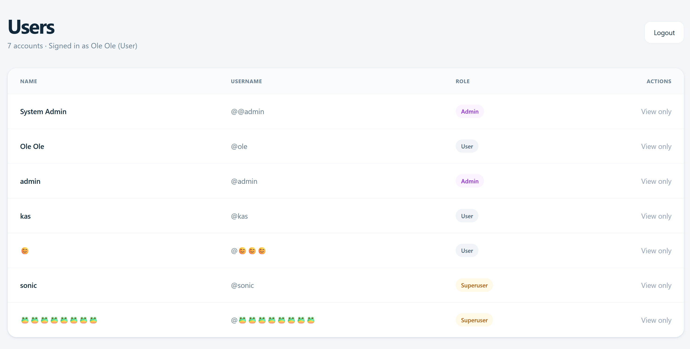
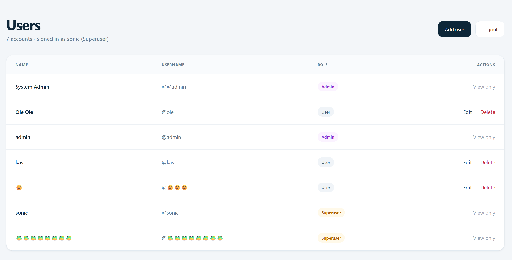
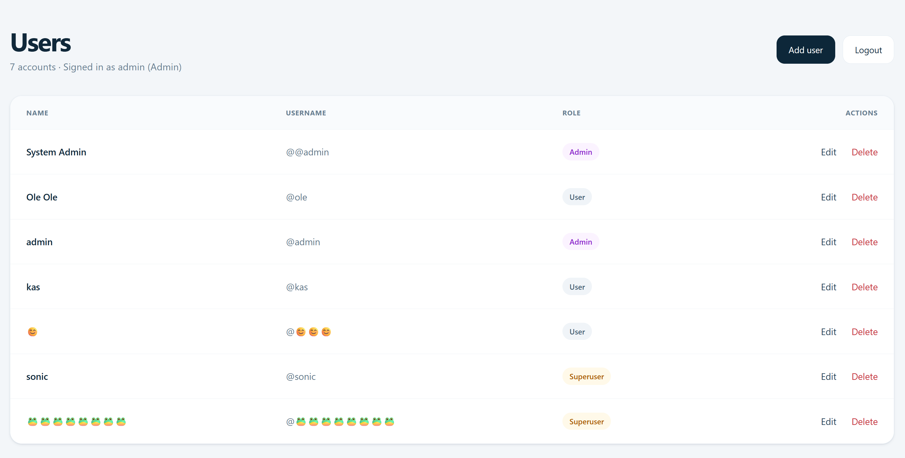
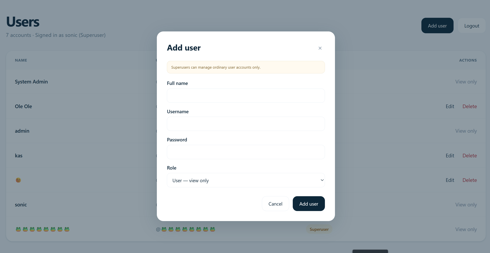
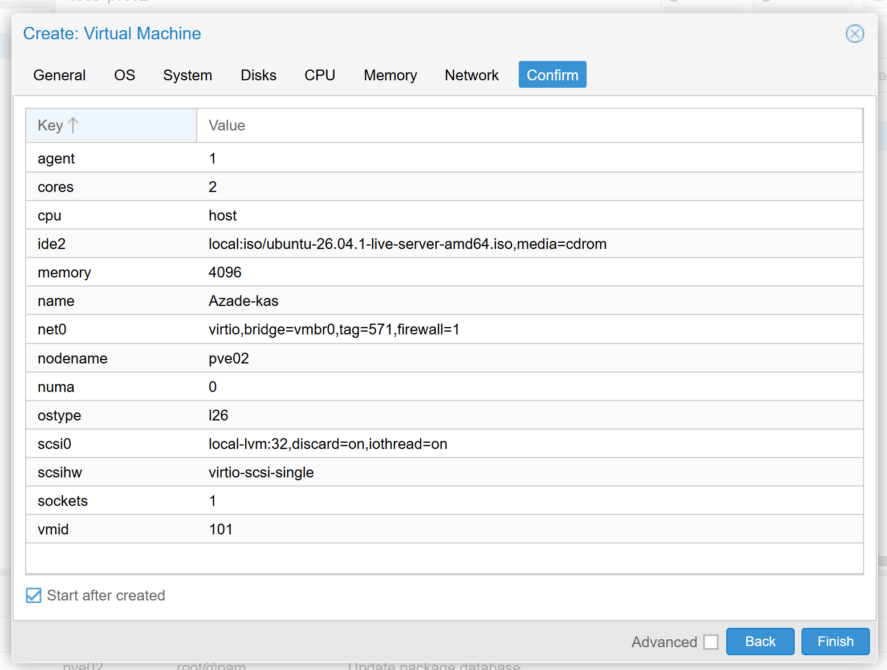
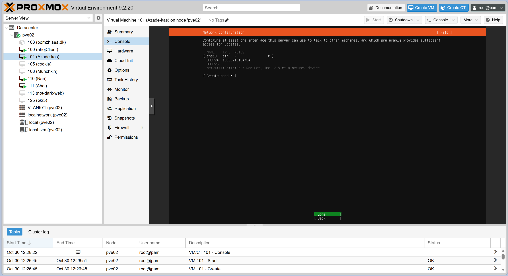
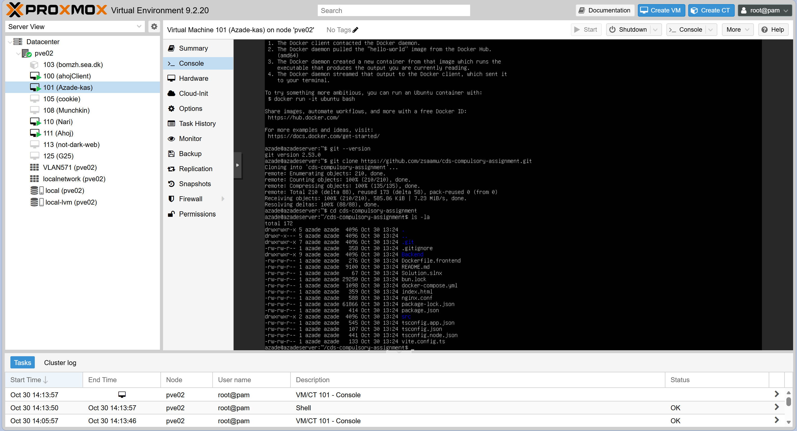

# CDS compulsory assignment

Login and user management platform for Kvist & Bjælke ApS, with network planning and Docker deployment. This README is the combined report for **CDS.security** and **CDS.infrastructure**.

Status: repository setup. Application development and deployment are pending.

## Responsibilities

| Member | GitHub | Responsibility                                                                                                                                           |
| --- | --- |----------------------------------------------------------------------------------------------------------------------------------------------------------|
| Samuele | [zsaamu](https://github.com/zsaamu) | Network plan, VMs, testing, report coordination, and final review/merge                                                                                  |
| Kyrylo | [Kyrylo-Vorona](https://github.com/Kyrylo-Vorona) | User account storage, username/password authentication, password hashing, and role permissions                                                           |
| Azade | [azade1416](https://github.com/azade1416) | Web login, user table, and account management actions for each role, install virtualization software, create Ubuntu Server VM, install and verify Docker |

Each member documents their own work. Samuele and Kyrylo handle Docker deployment together.

## First Admin Setup

The SQL query is:
```
INSERT INTO "Users" ("Fullname", "Username", "PasswordHash", "Role")
VALUES ('System Admin', '@admin', '$2a$11$JkBFAUgXsNma2OWzqtTQkOXVsiHTCRpYyRQ3/YX8armgq4nmqWKbC', 'admin');
```
The password is "password"
## Security Architecture
### Password Hashing (BCrypt)
User passwords are never saved in plain text in the database.

We use the BCrypt library (BCrypt.Net-Next) to hash passwords securely with an automatic salt.

This protects user data against database leaks and password cracking attacks.

### Authentication & Authorization (JWT)
The project uses JWT (JSON Web Tokens) for secure, stateless login.

After a successful login, the server creates a token using a secret key.

The token includes the user's ID, username, and role.

**Instant Session Control**: To keep the app secure, every protected request checks the database to verify if the user still exists and has the correct role. If an account is deleted or changed, the access updates immediately.

### How to test using Swagger UI
Send a POST request to /login using a test account's username and password.

Copy the token value from the response body.

Click the Authorize button (the lock icon) at the top right of the Swagger UI page.

Paste your token into the input field. (Note: You do not need to type the word "Bearer", just paste the token code).

Click Authorize and close the window. You can now test all protected endpoints based on your user role.


## Frontend Overview
Login


User



Superuser



Admin



Create a user




The frontend basically consists of:
1.	Login page
2.	One dashboard
3.	Dialog for creating a user

The login page takes users to the dashboard based on their roles. There are three roles.
All three have the same page design, but their access levels differ.

•	Admin: Can manage admins, superusers, and users.

•	Superuser: Can manage users.

•	User: Can only view and read user information.

Tests

The frontend is tested manually to check that the login page, dashboard, and create-user dialog work as expected. Testing also includes checking that each role has the correct access permissions.


# infrastructure

This screenshot displays the VM configuration in Proxmox, showing the network tag set to 571



Here is the Ubuntu network configuration showing the server has received the IP address 10.5.71.164 on VLAN 571



The completion of the Ubuntu Server installation, showing the system ready to reboot


The successful login screen for the Ubuntu Server, confirming the system is up and running with the assigned IPv4 address 10.5.71.164


This screenshot shows the installation process for Docker and Docker Compose on the Ubuntu Server


Here is the Docker installation and a successful hello-world test, which confirms that Docker is installed and functioning correctly


Here we have the source code downloaded to the Ubuntu Server via git clone, and the files for the application are visible




# Final reflection

Challenges:

One challenge was that we could not do the steps remotely. We had to be at the academy to get the correct IP.

The second challenge was when I created the virtual machine in Proxmox. In the Bridge field, I needed to enter vmbr0, but I couldn't type it manually or select it from the dropdown list because it was showing a "Connection error". This was annoying because my internet connection was fine, and vmbr0 was available under System → Network. It was important to add this because the bridge connects the Ubuntu VM to the academy's network. I had to refresh Proxmox multiple times. Later, vmbr0 finally appeared in the list, so I selected it quickly before another unexpected issue happened.
