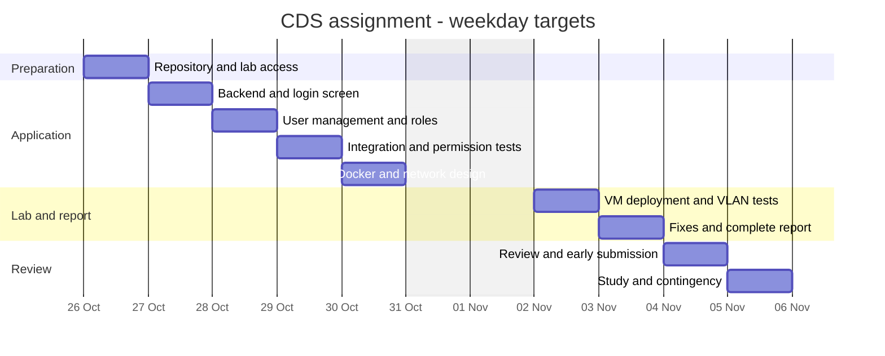

# Weekday plan

Dates below are local calendar dates for the team. These are targets, not completed results. No work is scheduled on Saturday 31 October or Sunday 1 November.

Finish implementation and the combined report by **Tuesday 3 November 2026**. Review and submit on **Wednesday 4 November**. Keep **Thursday 5 November** for study and unexpected problems. The official deadline in the brief is **Friday 6 November at 23:59 on Moodle**.

## Daily results

| Day | Work | Expected result |
| --- | --- | --- |
| Mon 26 October | Review the repository, agree ownership and API conventions, confirm lab access | Shared setup and a known route to the lab |
| Tue 27 October | Backend/database base, authentication, and frontend login work in parallel | A minimal login flow ready to connect |
| Wed 28 October | Add user management and checks for all three roles | Required actions available through API and interface |
| Thu 29 October | Integrate the real app and test permitted and forbidden requests | Working local flow with recorded checks |
| Fri 30 October | Verify Docker and finish addressing, subnetting, and the diagram | Application and network plan ready for the lab |
| Mon 2 November | Configure server/client VMs, deploy, and test between VLANs | Evidence of client access and role functions |
| Tue 3 November | Retest fixes and finish the README, evidence, and reflection | Complete project and report |
| Wed 4 November | Review the requirements together and submit the reviewed version | Early submission and confirmation |
| Thu 5 November | Study the full solution; use the buffer only if needed | Time to understand the work and handle surprises |

Do not leave the first lab-access check until 2 November. Confirm remote access or arrange the physical session now. If access cannot be arranged, update the affected issues and the plan.

## Timeline

## Issues and ownership

The owner coordinates the result; supporting members still document their own work. Samuele's tasks are assigned to `zsaamu`. Write-access invitations have been sent to `Kyrylo-Vorona` and `azade1416`. Their responsibilities are named below and in the issue descriptions; GitHub assignment is waiting for them to accept the invitations.

| Issue | Task | Owner | Target | Depends on |
| --- | --- | --- | --- | --- |
| [#1](https://github.com/zsaamu/cds-compulsory-assignment/issues/1) | Repository and shared plan | Samuele | 26 Oct | None |
| [#2](https://github.com/zsaamu/cds-compulsory-assignment/issues/2) | Lab access and VM addresses | Samuele | 26 Oct | None |
| [#3](https://github.com/zsaamu/cds-compulsory-assignment/issues/3) | Backend base and database setup | Kyrylo | 27 Oct | #1 |
| [#4](https://github.com/zsaamu/cds-compulsory-assignment/issues/4) | Login, hashing, and sessions | Kyrylo | 27 Oct | #3 |
| [#5](https://github.com/zsaamu/cds-compulsory-assignment/issues/5) | Login screen and session flow | Azade | 27 Oct | #1 |
| [#6](https://github.com/zsaamu/cds-compulsory-assignment/issues/6) | User management and backend permissions | Kyrylo | 28 Oct | #3, #4 |
| [#7](https://github.com/zsaamu/cds-compulsory-assignment/issues/7) | User table and forms | Azade | 28 Oct | #5 |
| [#8](https://github.com/zsaamu/cds-compulsory-assignment/issues/8) | Role boundary tests | Samuele; Kyrylo supports | 29 Oct | #4, #6 |
| [#9](https://github.com/zsaamu/cds-compulsory-assignment/issues/9) | Browser-to-API integration | Azade; Samuele supports | 29 Oct | #4, #6, #7 |
| [#10](https://github.com/zsaamu/cds-compulsory-assignment/issues/10) | IP plan and subnetting | Samuele | 30 Oct | #1 |
| [#11](https://github.com/zsaamu/cds-compulsory-assignment/issues/11) | Network diagram | Samuele | 30 Oct | #10 |
| [#12](https://github.com/zsaamu/cds-compulsory-assignment/issues/12) | Docker deployment | Kyrylo; Samuele supports | 30 Oct | #3, #4, #6, #9 |
| [#13](https://github.com/zsaamu/cds-compulsory-assignment/issues/13) | Server and client VMs | Samuele; Kyrylo supports | 2 Nov | #2, #12 |
| [#14](https://github.com/zsaamu/cds-compulsory-assignment/issues/14) | Deployment and VLAN evidence | Samuele; Kyrylo supports | 2 Nov | #12, #13 |
| [#15](https://github.com/zsaamu/cds-compulsory-assignment/issues/15) | Combined report and reflection | Samuele coordinates; everyone contributes | 3 Nov | #8, #9, #10, #11, #14 |
| [#16](https://github.com/zsaamu/cds-compulsory-assignment/issues/16) | Final review and shared understanding | Everyone; Samuele coordinates | 4 Nov | #15 |
| [#17](https://github.com/zsaamu/cds-compulsory-assignment/issues/17) | Moodle group and submission | Samuele | 4 Nov | #16 |

The [milestones](https://github.com/zsaamu/cds-compulsory-assignment/milestones) group the tasks into local preparation (30 October), lab deployment and report (3 November), and review/submission (4 November). A GitHub Projects board has not been created because the current connection lacks Projects permission. The timeline above and dated milestones are available without it.

## How a task becomes complete

Check the issue's acceptance list, record the actual verification, and update the relevant README section. Samuele reviews and tests the pull request, then decides whether to merge it into `main`. His own pull requests do not require another member's approval. Do not close a task only because code has been copied or a screenshot folder exists.

No oral presentation is specified in the compulsory assignment PDF. Explaining the solution together is a study and review activity.
